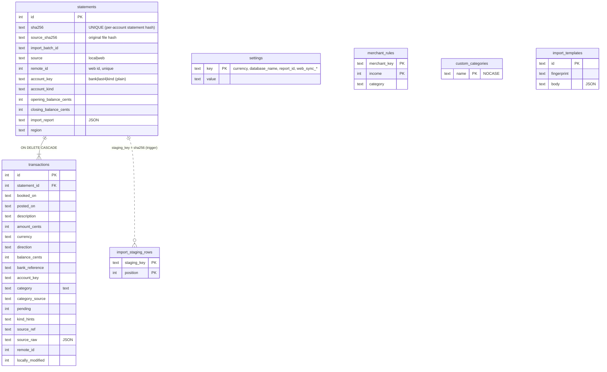
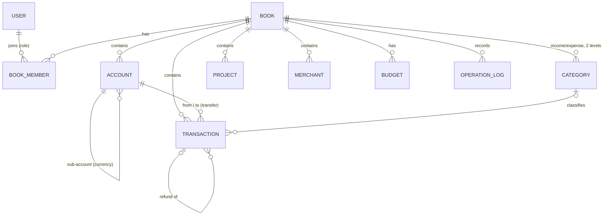
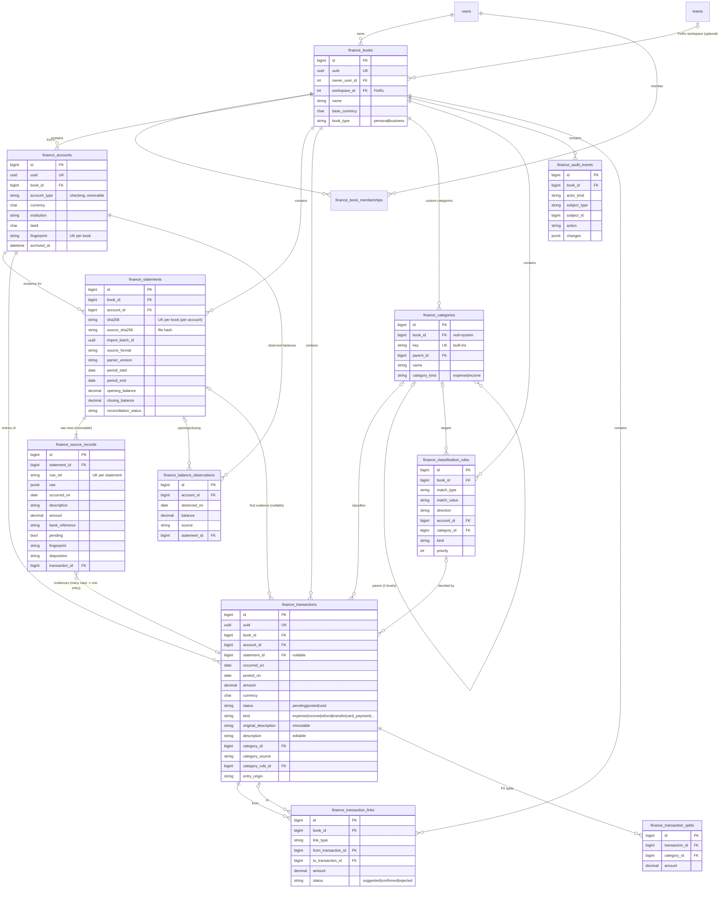
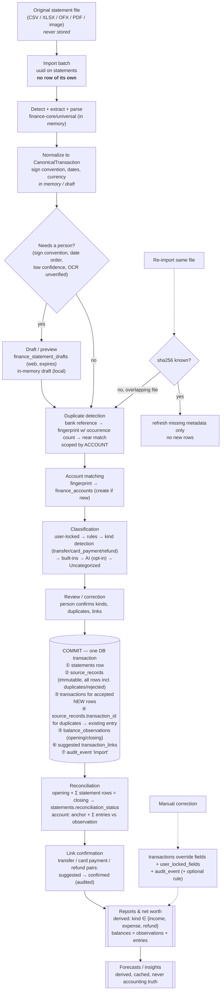
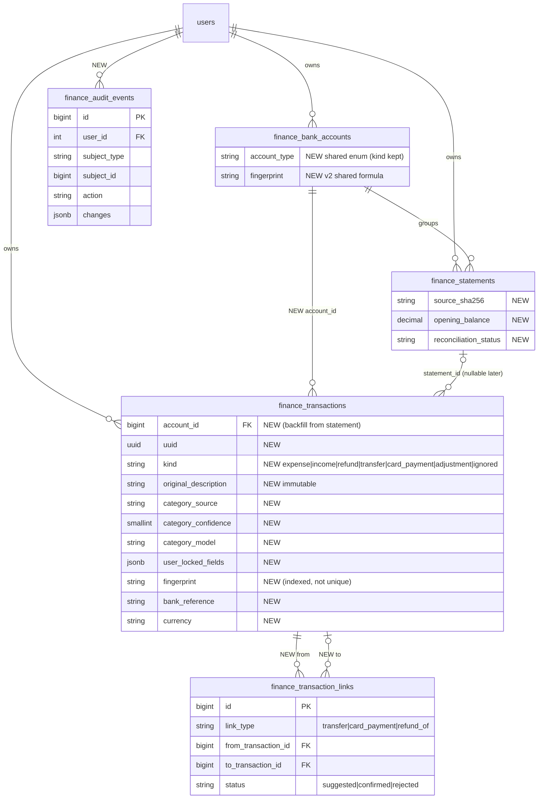

# BillieWeather Financial Database Architecture Review

**Status:** Research, audit and design only. No code, migrations, data, infrastructure or secrets were changed. Nothing here is approved for implementation.
**Date:** 2026-11-15
**Scope:** Rails/PostgreSQL (Neon) website, the Tauri/SQLite universal client (macOS, Windows, iOS, Android) and the shared TypeScript packages. Suishouji (随手记) is used as a product reference.
**Audience:** BillieWeather's owner and engineers who will implement the approved parts.

## How to read this document

Every claim carries one of these labels:

| Label | Meaning |
|---|---|
| **[Verified]** | I read it in the repository source. File and line references are given. |
| **[Observed]** | I saw it on a public Suishouji page (see §C sources). |
| **[Documented]** | Official Suishouji help, FAQ or store text says it. |
| **[Reported]** | A third-party write-up describes it. |
| **[Inferred]** | My deduction from the evidence. It is not confirmed. |
| **[Recommended]** | My proposal. It is not implemented. |
| **[Assumption]** | Something I could not verify and am treating as true for the analysis. |

Real financial data was not opened. Schema facts come from migrations, `db/schema.rb`, models and services. The examples use synthetic data. The folder `../local-db-backups-20261113/` (outside the repo) holds real SQLite files and was **not** opened; I only looked at its file names.

---

## Table of contents

- A. Existing Architecture
- B. Existing ERD
- C. Suishouji Reference Analysis
- D. Gap Analysis
- E. Recommended Target Schema
- F. Proposed ERD
- G. Transaction Lifecycle Diagram
- H. Database Strategy Comparison
- I. Compatibility Analysis (PostgreSQL and SQLite)
- J. Phased Migration Plan
- K. Risks and Open Questions
- L. Prioritized Recommendations (P0–P3)
- M. Minimum Viable Target Schema
- N. Answers to the Twelve Final Questions
- Appendix 1. Invariants
- Appendix 2. Synthetic worked examples

---

## A. Existing Architecture

### A.1 Deployment topology [Verified]

| Tier | Technology | Evidence |
|---|---|---|
| Website | Rails 8.1 (Bullet Train template), PostgreSQL. In production `DATABASE_URL` points to Neon's pooled endpoint, so advisory locks and prepared statements are turned off. | `config/database.yml:27-31,104-111`, `db/schema.rb:13` (`Schema[8.1]`, version `2026_11_13_000100`) |
| Local clients | React/TypeScript in Tauri 2 with `tauri-plugin-sql` (SQLite). Up to 8 database "slots" per device: `billieweather.db`, `billieweather-2.db`, … | `clients/universal/src-tauri/src/lib.rs:8-20,64-68` |
| Browser preview and tests | sql.js (in-memory SQLite) through the same `SqlDriver` interface | `clients/universal/src/services/sqljsDriver.ts`, `store.ts:9-12` |
| Shared logic | `packages/finance-core`: categorizer, CSV/PDF parsing, the universal import pipeline, money, regions. `packages/shared-types`, `packages/reporting`. | `packages/finance-core/src/universal/README.md` |
| Forecasting | `billieforecast/` is a Python (Prophet) service called over HTTP. Its results are cached in `Rails.cache` and are not stored in any table. | `app/services/finance/billie_forecast_client.rb`, `data_deletion.rb:34-40` |

Platform coverage (macOS, Windows, iOS, Android, plus Linux) is confirmed by `Finance::LocalDevice::PLATFORMS` (`app/models/finance/local_device.rb:10`) and the platform-specific code in `src-tauri/src/device.rs`.

### A.2 Tenancy model [Verified]

- **Every finance table is owned by a `user_id`.** None of them references Bullet Train's `teams` or `memberships` (`db/schema.rb:611-625`). Those tables exist (`schema.rb:339-358,469-477`) but finance does not use them.
- Every controller query is scoped through `current_user`, for example `current_user.finance_transactions.find(params[:id])` (`app/controllers/finance/transactions_controller.rb:76`) and `Finance::Statement.where(user_id: current_user.id)` (`client_api/v1/finance_controller.rb:103`).
- Cross-row ownership is checked in the models, not the database: `Statement#bank_account_belongs_to_user` (`statement.rb:18-20`) and `Transaction#same_owner_as_statement` (`transaction.rb:37-41`). No composite foreign key enforces it.
- On the device, a SQLite file has **no owning account**. See §K risk R1.

### A.3 Web finance tables (PostgreSQL) [Verified]

All primary keys are `bigint` identity (`id`). All `user_id` FKs reference `users.id` (an `integer`/serial). "Auth" means authoritative data; "Derived" means it can be recomputed or is a cache.

#### `finance_profiles` (`schema.rb:249-262`, model `app/models/finance/profile.rb`)

| Column | Type | Notes |
|---|---|---|
| user_id | bigint NOT NULL, **unique** | FK users. One per user. |
| currency | string NOT NULL default `USD` | The **single currency for the whole user** (`profile.rb:5`: USD CAD EUR GBP AUD NZD SGD HKD CNY JPY). Cannot change once statements exist (`profile.rb:54-59`). |
| current_balance | decimal(15,2) NOT NULL default 0 | **Derived cache or manual override.** Written by `BalanceSync` (`balance_sync.rb:14-20`) unless `balance_source = 'manual'`. |
| balance_source / balance_as_of | string / date | `statement`, `manual` or nil |
| cash_on_hand / cash_on_hand_on | decimal(15,2) / date | **Auth (manual).** Physical cash as one number, not an account. |
| tax_country / tax_profile | string | Defaults `United States` / `personal` |

- Deletion: `User has_one :finance_profile, dependent: :destroy` (`user.rb:5`).
- Mixed role: user settings (currency), a derived cache (current_balance) and an authoritative manual figure (cash_on_hand) share one row.

#### `finance_bank_accounts` (`schema.rb:134-146`, `bank_account.rb`)

| Column | Type | Notes |
|---|---|---|
| user_id | bigint NOT NULL | FK users |
| identity_key | string NOT NULL | `SHA256(normalize(bank)|last4|kind)` (`statement_account_identity.rb:121-123`). Unique `(user_id, identity_key)`. |
| bank_name, name, last4 | string NOT NULL | `last4` must be 4 digits (`bank_account.rb:12`). Full numbers are never stored. |
| kind | string NOT NULL default `unknown` | `cash` \| `credit` \| `unknown` (`bank_account.rb:5`) |
| custom_name | string | User label; always wins (`bank_account.rb:29-31`) |

- **Missing:** currency, opening balance, asset/liability class, archived flag, and any account that is not a bank (cash wallet, Venmo, loan, investment).
- An account exists **only as a by-product of statement import** (`BankAccount.resolve`, `bank_account.rb:18-26`). There is no way to create one directly.
- Deletion: `has_many :statements, dependent: :nullify` (`bank_account.rb:7`), so deleting an account leaves its statements unassigned.
- Auth (identity) plus some derived names.

#### `finance_statements` (`schema.rb:283-299`, `statement.rb`)

| Column | Type | Notes |
|---|---|---|
| user_id | bigint NOT NULL | FK users |
| bank_account_id | bigint NULL | FK `finance_bank_accounts` (no `on_delete`; the model nullifies) |
| filename | string NOT NULL | |
| currency | string NOT NULL | Must equal the profile currency |
| sha256 | string NOT NULL | **Unique `(user_id, sha256)`**: file-level idempotency |
| status | string NOT NULL default `imported` | Only `imported` is allowed (`statement.rb:12`). Unused state machine. |
| transaction_count | integer NOT NULL | Denormalized count, > 0 |
| closing_balance / closing_balance_on | decimal(15,2) / date | Read from the file when possible |
| balance_observed_on | date | Latest transaction date or closing date |

- **Missing:** opening balance, period start and end, source format, parser version, import batch, reconciliation result, and file-hash vs per-account hash (the local schema has these; see A.4).
- Deletion: `has_many :transactions, dependent: :destroy` (`statement.rb:7`). Deleting a statement hard-deletes its transactions **including the person's category edits**.
- Auth (provenance record).

#### `finance_transactions` (`schema.rb:301-315`, `transaction.rb`)

| Column | Type | Notes |
|---|---|---|
| user_id | bigint NOT NULL | FK users |
| statement_id | bigint **NOT NULL** | FK `finance_statements` (no `on_delete`). **Every transaction must come from a statement.** |
| booked_on | date NOT NULL | One date. No posted vs transaction date distinction. |
| description | string(500) NOT NULL | **Editable by the user** (`transactions_controller.rb:52` permits `:description`). The original text is then lost. |
| amount | decimal(15,2) NOT NULL | Signed: positive is money in. Cent precision is validated (`transaction.rb:30-35`). |
| category | string NOT NULL default `Uncategorized` | **Free text name**, not an FK. Built-ins in `Transaction::CATEGORIES` (`transaction.rb:5`) or a custom name. |
| tax_review | boolean | Set when category is `Business` |
| excluded | boolean | The user hides a row from totals |

- Indexes: `(user_id, booked_on)`, `statement_id`, `user_id`.
- **No uniqueness of any kind** (no fingerprint, no bank reference).
- No `bank_account_id` (only through the statement), no currency column, no kind, no pending flag, no category provenance, no raw source.
- Auth: the only store of financial events, and it mixes source facts with user corrections.

#### `finance_statement_drafts` (`schema.rb:264-281`, `statement_draft.rb`)

- A PDF parse waiting for review: rows are kept as `jsonb` (up to 500, `statement_draft.rb:5`), plus warnings and `expires_at` (at most 31 minutes ahead, `statement_draft.rb:69-73`).
- Transient. It is deleted when imported (`draft_import.rb:27`).
- Not authoritative. A short-lived staging record.

#### `finance_merchant_rules` (`schema.rb:238-247`, `merchant_rule.rb`)

- `(user_id, merchant_key, income)` unique, plus `category` text.
- A "remember my change" rule, created when a person recategorizes a row (`transactions_controller.rb:64-73`, `merchant_rule.rb:17-30`).
- No priority, account scope, provenance, history or kind override.
- Auth (user intent).

#### `finance_custom_categories` (`schema.rb:165-172`, `custom_category.rb`)

- `(user_id, lower(name))` unique, at most 50 per user, flat (no parent).
- Renaming **rewrites every transaction and rule that holds the old name** (`custom_category.rb:56-71`). Deleting moves those transactions to `Uncategorized` and deletes the rules (`:75-83`).
- Auth.

#### `finance_insights` (`schema.rb:174-185`)

- AI or rule-generated text (`source` ∈ `rules`, `openai`; `kind` ∈ `general`, `tax`) in `content jsonb`.
- **Derived.**

#### `finance_command_executions` (`schema.rb:148-163`, `command_execution.rb`)

- Idempotency key, the result for replays, and an **undo payload** for the command bar (`Finance::SmartCommand`).
- Pruned after 1 day (`command_execution.rb:8,14-16`).
- The only "audit-like" record of user edits, and it is short-lived. Operational, not an audit trail.

#### Local database metadata: `finance_local_devices`, `finance_local_database_reports`, `finance_local_database_audits` (`schema.rb:187-236`)

- **`finance_local_devices`:** unique `(user_id, device_id uuid)`, plus `platform`, `label` and the `purged_through` watermark.
- **`finance_local_database_reports`:** unique `(user_id, device_id, database_id)`. Holds metadata only: name, size, counts, period, `sequence`, `status` (`active`/`review`/`archived`), tombstone `deleted_at` and `synced_at`.
  - Written with a single `INSERT … ON CONFLICT … WHERE sequence < EXCLUDED.sequence` under a per-user row lock (`local_database_report.rb:60-78,129-145`).
  - Cross-device identity conflicts go to review or archive, with audit entries (`:168-199`).
- **`finance_local_database_audits`:** append-only and read-only once persisted (`local_database_audit.rb:17`).
- The link between reports and devices is the logical pair `(user_id, device_id)`. **It is not a database FK** (`local_device.rb:13-14`).
- These are well designed: idempotent, ordered, tombstoned and audited. See §D.6.

### A.4 Local SQLite schema (per database file) [Verified]

Migrations live in `clients/universal/src-tauri/migrations/0001…0006` and are registered in `lib.rs:22-61`. The same migrations run for every slot.

| Table | Purpose | Key facts |
|---|---|---|
| `settings` | Key/value store | `currency`, `database_name`, `report_id` (**the database identity**, a random UUID: `store.ts:665-682`), `web_sync_enabled`, `web_sync_version`, `web_sync_skip`, `last_synced_at` |
| `statements` | One imported document per account | `sha256 UNIQUE`, `source` (`local`/`web`) plus `remote_id` (web id, unique when set). From 0004: `import_batch_id`, `source_sha256` (original file hash), `source_format`, `account_key`, `institution`, `account_last4`, `account_kind`, `opening_balance_cents`/`_on`, `import_report` JSON. From 0005/0006: `region`, `region_source`, `detected_region`, `region_confidence`, `region_evidence`. |
| `transactions` | Canonical rows | `amount_cents INTEGER`, `statement_id NOT NULL REFERENCES statements ON DELETE CASCADE`, `category` text (1–40 chars), `remote_id`, `locally_modified`. From 0004: `posted_on`, `normalized_merchant`, `currency`, `direction`, `balance_cents`, `bank_reference`, `account_key`, `category_source` (`user`/`rule`/`file`/`auto`/`region`/`legacy`), `pending`, `kind_hints`, `source_ref`, `parse_confidence`, `validation_status`, `source_raw` JSON. Indexes include `(booked_on, amount_cents)` for dedupe and `bank_reference`. |
| `merchant_rules` | Remembered categories | PK `(merchant_key, income)` |
| `custom_categories` | User categories | PK `name COLLATE NOCASE` |
| `import_staging_rows` | Atomic import staging | PK `(staging_key, position)`. Moved into `transactions` by trigger `statements_commit_staged` (0004:83-97), so the statement and its rows appear together or not at all. |
| `import_templates` | Saved column mappings | `fingerprint` index |

Key observations [Verified]:

1. **Money representations differ.** SQLite uses integer cents. PostgreSQL uses `decimal(15,2)`. Both are exact at scale 2, and the conversion is string-based (`finance_controller.rb:205-207` emits `"-12.50"` and the client calls `decimalToCents`). This is safe.
2. **The local schema is richer than the web schema.** It has row provenance (`source_raw`, `source_ref`), category provenance, pending, posted date, bank reference, per-transaction account key, opening balance and the import report. The website has none of these.
3. **Account identity formats differ:**
   - Web: `identity_key = SHA256("bank|last4|cash|credit")` (`statement_account_identity.rb:122`).
   - Local: `account_key = "bank|last4|checking|savings|credit_card|loan"` in plain text (`packages/finance-core/src/universal/schema.ts:166-170`).
   - The kind vocabularies differ too (`cash/credit/unknown` vs `checking/savings/credit_card/loan/unknown`). The same physical account gets different keys on the two sides.
4. **There is no account table locally.** Accounts exist only as `account_key` strings on statements and transactions.
5. **Row-level duplicate detection exists only locally** (`relations.ts:34-80`: bank reference, then date+amount+description with occurrence counting, then a near match on merchant key). It is account-scoped, but a `null` account key matches any account (`compatible()`, `relations.ts:23`).
6. **Transfer and card-payment detection exists only as hints locally** (`relations.ts:88-111`, `normalize.ts:71-73`). Nothing pairs records.
7. **Credit-card sign convention:** locally, the import refuses to commit a single-amount credit-card file until the sign convention is confirmed (`normalize.ts:180,320-321`). **The web importer has no such step** (see §D.2).
8. **Pending rows are skipped by default** (`pipeline.ts:568`). They are never stored, so a pending → posted lifecycle does not exist.

### A.5 Data movement between web and devices [Verified]

| Flow | Direction | Trigger | What moves | Evidence |
|---|---|---|---|---|
| Web download ("copies of website statements") | Web → device | Automatic on sign-in when `web_sync_enabled`, using a version fingerprint | Statements, transactions, rules, custom categories. Read-only copies with `source='web'`. A local edit sets `locally_modified`, and that edit wins. Web deletions remove the local copies. | `webSync.ts`, `store.ts:899-1000`, `finance_controller.rb:19-44` |
| Statement upload ("Sync to cloud") | Device → web | **Explicit**, per statement, after confirmation | One statement with its rows (date, description, amount, category, flags). **No account identity, no provenance, no region.** | `cloudUpload.ts`, `finance_controller.rb:65-97` |
| Metadata report | Device → web | Automatic for signed-in users | Allow-listed metadata only (names, size, counts, dates, sequence) | `localReport.ts:10-14`, `local_database_report.rb:22-23` |
| Local ↔ local copy | Device DB → device DB | Explicit | `TransferStatement` including region | `transfer.ts`, `store.ts:84-110` |
| Backup | — | **Not implemented** ("Coming soon" button, disabled) | — | `pages/Data.tsx:472-475`, `i18n/en.ts:165-167` |

Privacy and local-first properties hold [Verified]:

- Uploads are explicit.
- Metadata is allow-listed.
- AI categorization sends only cleaned merchant text and direction (`ai_categorizer.rb:10-14`, `finance_controller.rb:149-173`).
- `docs/overnight-audit.md` §C.3 independently confirms that the CSP limits network egress.

### A.6 Import, classification and reporting services [Verified]

**Web import pipeline:**

```
BatchStatementImport (≤10 files, ≤10 MB, 25 s budget)            batch_statement_import.rb
 ├─ CSV → StatementImporter.call                                  statement_importer.rb
 │    parse_rows (in memory) → user.with_lock {
 │      Profile currency check → Statement.find_by(sha256) → refresh_missing_details or
 │      Statement.create! → Transaction.insert_all!(500/batch) }  :98-127
 │    → Categorizer.recategorize_uncategorized! → BalanceSync.call :129-130
 └─ PDF → PdfStatementExtractor → StatementDraft (review ≤30 min)
          → DraftImport re-serializes reviewed rows as CSV → StatementImporter  draft_import.rb:17-26
```

- File idempotency: a re-upload of the same bytes only fills missing account or balance details; otherwise it is rejected as a duplicate (`statement_importer.rb:103-108,142-160`).
- **No row-level duplicate detection.** Two different files covering the same days (a monthly PDF plus a 90-day CSV export) produce two copies of every overlapping transaction.

**Classification order:**

1. Learned `MerchantRule` by (merchant_key, direction).
2. The `TRANSFERS` regex.
3. **Any positive amount becomes `Income`.**
4. Keyword lists.
5. `Uncategorized`.

Source: `categorizer.rb:64-71`. The test suite asserts that a refund is categorized as Income (`test/services/finance/categorizer_test.rb:57`).

AI categorization changes only `Uncategorized` rows and records no provenance (`ai_categorizer.rb:172-181`).

**Totals:** `Transaction.included = excluded = false AND category <> 'Transfers'` (`transaction.rb:10`). This scope drives:

- `Snapshot` (income = Σ positive, expenses = Σ negative): `snapshot.rb:21-34`
- `SpendingBreakdown`: `:108-110`
- `CashFlowForecast`: `:30-42,127-129`
- `Report`: `report.rb:79`

So **"transfer" is a category name**, and income/expense is the **sign** of the amount, summed across every account kind.

**Balances:** `BalanceSync` uses only the **newest** statement of each `cash` account and adds up their closing balances. Credit accounts are reported separately as "owed". Unknown-kind accounts and unassigned statements make the summary incomplete (`balance_sync.rb:26-70`). Net worth (assets − liabilities) is never computed.

---

## B. Existing ERD

### B.1 Web (PostgreSQL), finance-related tables only [Verified]

```mermaid
erDiagram
    users ||--o| finance_profiles : "has one (dependent destroy)"
    users ||--o{ finance_bank_accounts : owns
    users ||--o{ finance_statements : owns
    users ||--o{ finance_statement_drafts : owns
    users ||--o{ finance_transactions : owns
    users ||--o{ finance_merchant_rules : owns
    users ||--o{ finance_custom_categories : owns
    users ||--o{ finance_insights : owns
    users ||--o{ finance_command_executions : owns
    users ||--o{ finance_local_devices : "owns (FK cascade)"
    users ||--o{ finance_local_database_reports : "owns (FK cascade)"
    users ||--o{ finance_local_database_audits : "owns (FK cascade)"
    users ||--o{ memberships : "Bullet Train (unused by finance)"
    teams ||--o{ memberships : has

    finance_bank_accounts |o--o{ finance_statements : "groups (nullify)"
    finance_bank_accounts |o--o{ finance_statement_drafts : "groups (nullify)"
    finance_statements ||--|{ finance_transactions : "contains (destroy)"
    finance_local_devices ||..o{ finance_local_database_reports : "logical (user_id, device_id), no FK"

    finance_profiles {
        bigint id PK
        bigint user_id FK "unique"
        string currency "single currency per user"
        decimal current_balance "derived cache or manual"
        string balance_source
        date balance_as_of
        decimal cash_on_hand "manual"
        string tax_country
        string tax_profile
    }
    finance_bank_accounts {
        bigint id PK
        bigint user_id FK
        string identity_key "sha256(bank|last4|kind), unique per user"
        string bank_name
        string name
        string last4
        string kind "cash|credit|unknown"
        string custom_name
    }
    finance_statements {
        bigint id PK
        bigint user_id FK
        bigint bank_account_id FK "nullable"
        string filename
        string currency
        string sha256 "unique per user"
        string status "always imported"
        int transaction_count
        decimal closing_balance
        date closing_balance_on
        date balance_observed_on
    }
    finance_transactions {
        bigint id PK
        bigint user_id FK
        bigint statement_id FK "NOT NULL"
        date booked_on
        string description "user-editable, original lost"
        decimal amount "15,2 signed"
        string category "free-text name"
        bool tax_review
        bool excluded
    }
    finance_statement_drafts {
        bigint id PK
        bigint user_id FK
        bigint bank_account_id FK
        string sha256
        jsonb rows "<=500, transient"
        jsonb warnings
        datetime expires_at
    }
    finance_merchant_rules {
        bigint id PK
        bigint user_id FK
        string merchant_key
        bool income
        string category "text"
    }
    finance_custom_categories {
        bigint id PK
        bigint user_id FK
        string name "unique lower(name) per user"
    }
    finance_insights {
        bigint id PK
        bigint user_id FK
        string source
        string kind
        jsonb content "derived"
    }
    finance_command_executions {
        bigint id PK
        bigint user_id FK
        string idempotency_key
        jsonb undo_payload "pruned after 1 day"
    }
    finance_local_devices {
        bigint id PK
        bigint user_id FK
        string device_id "uuid, unique per user"
        string platform
        string label
        bigint purged_through
    }
    finance_local_database_reports {
        bigint id PK
        bigint user_id FK
        string device_id
        string database_id "uuid from SQLite settings.report_id"
        string name
        bigint sequence
        string status "active|review|archived"
        datetime deleted_at "tombstone"
    }
    finance_local_database_audits {
        bigint id PK
        bigint user_id FK
        string event
        jsonb details
    }
```



### B.2 Local (SQLite), one database file [Verified]



---

## C. Suishouji Reference Analysis

### C.1 Sources and method

- **Primary source:** the official Suishouji user manual 随手记-用户功能手册, at `https://feidee.com/docs/`. It was updated between 2026-07 and 2026-11. Each article is at `https://feidee.com/docs/?articleId=N`; the article number is given in brackets below, for example (art. 423).
- **Also used:**
  - The public template market at `https://www.feidee.com/cloud/#/market`.
  - The privacy policy at `https://www.sui.com/help/privacy.jsp`.
  - Two third-party write-ups:
    - `https://zhuanlan.zhihu.com/p/635699665`
    - `https://www.yigujin.cn/blog/p2692.html`
- **Method:** the pages were read logged out, the way any visitor sees them. Logins were not bypassed. The pages were read during a delegated research pass. I did not re-open every article myself, so treat the article numbers as citations to check, not as verified quotes.
- **What is behind login:** `https://www.feidee.com/cloud/#/` is partly public. The navigation, the "recent / create book" area, the guides and the template market are visible without signing in. The contents of a book need a login.
- **Two kinds of book:**
  - **神象云账本** is the new cloud book.
  - **同步账本** is the legacy synced book.
  - Many advanced features are documented only for 神象云 books, and some are paid (membership or 香蕉贝).

### C.2 Observable concepts

| Concept | What Suishouji does | Label |
|---|---|---|
| **Book (账本)** | "One book is one bookkeeping scenario". The manual advises against mixing unrelated finances in one book. There are 100+ templates (family, personal, business, renovation, travel, landlord, …), and each comes with preset categories and roles. Books are limited in number (28 free). Deleted books can be restored within 7 days. Ownership can be handed to another member. | [Documented] (art. 387, 405, 48, 421); [Observed] market cards |
| **Year-end carry-over (账本结转)** | Creates a new book. Accounts, balances, categories, projects, merchants, members, loan contacts and open loans are copied. Older transactions are copied only if chosen. The old book stays usable. | [Documented] (art. 50) |
| **Custom month start** | A "month" can start on payday or the card statement day. Reports and budgets follow it. | [Documented] (art. 34) |
| **Members and roles** | **Virtual members** are labels such as "husband" or "child", used for tagging and statistics. **Joined members** are real users. Roles are owner, admin, advisor (manages master data, cannot see transactions), member (edits only their own entries), partner (view-only) and finance. Custom roles can restrict add/edit/delete/view, master data, the operation log and **"may view account balances / assets and liabilities"**. Recurring entries post as a "robot" member. | [Documented] (art. 410, 420, 446) |
| **Accounts (账户)** | Seven types: cash, credit card, financial (savings card), liability, receivable (债权), investment, virtual (WeChat Pay, Alipay). Accounts have an initial balance, can be hidden (history is kept) and can be copied to other books. **Sub-accounts in different currencies** must be added when the account is created. | [Documented] (art. 409, 439) |
| **Assets, liabilities and net worth** | The account report shows the book's net assets and its assets and liabilities. A chart shows net assets over time. | [Documented] (art. 407, 427) |
| **Categories** | Separate income and expense trees, two levels (一级/二级), preset per template, can be hidden or copied. | [Documented] (art. 417) |
| **Other dimensions** | **Project (项目)**, **merchant (商家**, which also covers customers and suppliers) and **member** are independent of accounts and categories. Budgets, reports, export and period locking can all filter on account, category, member, merchant and project. No free-form tag dimension was found. | [Documented] (art. 412, 413, 423) |
| **Transaction types** | Eight types: expense, income, transfer, balance, loan (借贷), paid-for-someone (代付), reimbursement (报销) and refund (退款). The rules for each: | [Documented] (art. 423) |
| ↳ Transfer | Requires a source **and** a destination account. | |
| ↳ Balance | Requires only the account. It aligns the recorded balance with reality. | |
| ↳ Refund | **Links to the original expense.** One expense can have several partial refunds. | |
| ↳ Loan, paid-for, reimbursement | Create payables or receivables against a contact. | |
| **Loan center (借贷中心)** | Contacts (借贷人) are tied to receivable and liability accounts. Collections and repayments can be settled in bulk. Company reimbursement is modelled as a contact. | [Documented] (art. 414, 439) |
| **Credit card repayment** | Card spending is an expense from a liability account. Repayment is a **transfer** from the savings account to the card account, which "automatically reduces the amount owed". | [Documented] (art. 439); [Reported] Zhihu |
| **Reconciliation (对账)** | Turned on per account, it shows the running balance after each transaction so it can be compared with the bank statement. | [Documented] (art. 409) |
| **Balance edits** | In older apps, editing an account balance created a dated "balance change" entry. | [Reported] (yigujin.cn, 2021) |
| **Budgets** | Spending budgets and income targets by category (either level), account, member, merchant or project. Periods: day, week, month, quarter, year. Alerts at 90% and 100%. | [Documented] (art. 438) |
| **Reports and charts** | Basic, category share, member, account (net assets), project (profit) and merchant reports, plus a report library. Export to Excel is paid. | [Documented] (art. 407, 427) |
| **Multiple currencies** | Each book has a base currency (本位币) and exchange rates. Each account can have its own currency, and its amounts are converted. The docs do not say where the rates come from. | [Documented] (art. 348) |
| **Import** | AI import (any file), WeChat, Alipay, a general template and the web version. A Chrome extension imports from Alipay and some banks. The privacy policy mentions parsing online-banking, email, loan and WeChat bills after the user logs in to that service. An old help snippet says a batch import can be undone. | [Documented] (art. 443, 349); [Observed] privacy policy; [Reported] undo |
| **Duplicates** | Detection and merging of duplicate transactions is in **beta**. | [Documented] (art. 444) |
| **Operation log (操作日志)** | Records transaction create/edit/delete, budget changes, book changes, roles and invitations, and advanced actions (lock, export, trash, import, carry-over). It can be filtered by time and person. | [Documented] (art. 373) |
| **Trash (流水回收站)** | Deleted transactions, including those removed when their category or account was deleted, can be restored. It can be filtered by who deleted them and when. | [Documented] (art. 382) |
| **Period lock (封账)** | Locks a range defined by date, account, member, merchant and/or project. Locked entries cannot be added, edited or deleted, and imports into the range are blocked. Only the owner or an admin can lock or unlock. | [Documented] (art. 416) |
| **Sync and web** | 神象云 books are cloud-native and fully editable on the web. Legacy books sync from devices (full sync, sync locked, local backup) and are view-only on the legacy web. | [Documented] (art. 54, 429, 357, 426) |
| **Web app modules** | The cloud page's HTML loads modules named Books, BookTransaction, BookReport, BookPermission, BookRole, BookUser, FinanceAccount, FinanceCategory, FinanceMember, FinanceMerchant, FinanceProject, AccountImport and AccountExport. | [Observed] |

### C.3 Relationships among Books, Accounts, Transactions, Categories and Users

**What is documented or observed:**

- A **book** is the container. Accounts, categories, projects, merchants, members, budgets, the operation log, the trash and period locks all belong to one book.
- Accounts and categories can be *copied* between books but are not shared. Cross-book search and reports are a separate feature (art. 401).
- **Users** join a book as members with a role. Virtual members are labels inside the book, not users.
- A **transaction** has a type. Expenses, income and refunds carry one category and one account. Transfers carry two accounts and no category. Every transaction can optionally carry a member, a project and a merchant.

**[Inferred]**, not confirmed by any documentation:

- Each transaction stores optional references to account(s), category, member, project and merchant. The same five filter dimensions appear in budgets, reports, export and locks, which suggests this.
- A refund holds a reference to its original expense.
- Loans and reimbursements are transactions against receivable or liability accounts, plus a contact.
- Sub-accounts are child accounts, each with its own currency.
- Roles are permission sets attached to each book membership.
- Suishouji presents a **single-entry, typed-transaction model with two-account transfers**. That is effectively option C in §H. There is no public evidence of a double-entry journal underneath. **Suishouji's internal database schema is not publicly documented, and I make no claim about it.**



*This diagram is a conceptual reading of the documented behaviour, labelled [Inferred]. It is not Suishouji's schema.*

### C.4 What BillieWeather should borrow, and what it should not

| Suishouji idea | Adopt? | How it maps to BillieWeather |
|---|---|---|
| A book is one isolated scenario, with a base currency | **Yes** | `finance_books`. A local SQLite file is already one book. |
| Typed transactions where income/expense is a type, not a sign | **Yes (core)** | `transactions.kind` (§E.3) |
| A transfer has two accounts; card repayment is a transfer to a liability account | **Yes** | `transaction_links` (transfer, card_payment) plus the liability `account_class` |
| A refund links to the original expense and nets against its category | **Yes** | `refund` kind plus a `refund_of` link |
| Account types, including liabilities, receivables and virtual wallets; net assets | **Yes** | The `account_type` enum. Net worth is derived. |
| Initial balance and balance entries | **Partly** | Use balance *observations* (anchors), not fake income or expense entries |
| Per-account running balance for reconciliation | **Yes** | Statement and account reconciliation (I-5, I-6) |
| Two-level categories | **Later (P2)** | `parent_id` |
| Project, merchant and member dimensions | **Merchant only, later** | `merchant_key` now; projects and members are FinRx or P3 |
| Operation log and trash | **Yes** | `finance_audit_events`; soft delete for manual entries |
| Period lock | **Later (FinRx)** | Useful after tax filing. Not needed for MVP. |
| Roles, including "may not see balances" | **FinRx** | Teams and memberships |
| Year-end carry-over into a new book | **No** | BillieWeather's analysis depends on continuous history. Use reporting periods instead. |
| A manual-first workflow | **No** | BillieWeather stays import-first. Suishouji's duplicate detection is still in beta, while BillieWeather's local pipeline is already stronger in this area, so make that pipeline the standard. |

---

## D. Gap Analysis

### D.1 Concept coverage matrix

Legend:

- ✅ present and sound
- 🟡 present but weak or implicit
- ❌ absent
- n/a not needed

| Concept | Web today | Local today | Gap and evidence | Recommended disposition |
|---|---|---|---|---|
| User | ✅ `users` | ❌ (only an email in the session) | A local DB has no owner (R1) | Keep. Bind local DBs to an immutable account id. |
| Workspace | 🟡 Bullet Train `teams` (unused) | ❌ | — | **FinRx only**: reuse `teams` as the workspace. Not for BillieWeather. |
| Book / Ledger | ❌ (the user *is* the book) | 🟡 Each SQLite file acts as a book | The local "database" concept already equals a book. The web cannot represent two books. | **Real table** (Phase 4), with one default book per user. |
| Book Membership | ❌ | ❌ | — | FinRx extension. BillieWeather: owner only. |
| Financial Account | 🟡 `finance_bank_accounts` (cash/credit/unknown) | 🟡 `account_key` strings | No cash, wallet, loan or investment accounts. No currency or opening balance. Keys are incompatible across platforms. | **Modify** the existing table and add a local `accounts` table. |
| Account Type | 🟡 `kind` string | 🟡 `account_kind` | The two vocabularies differ | **Field** with one shared enum. Asset/liability is **derived** from type. |
| Statement | ✅ `finance_statements` | ✅ `statements` (richer) | Web lacks opening balance, period, format, file hash vs account hash | Keep. Add columns. |
| Import Batch | ❌ | 🟡 `import_batch_id` field | — | **Field** (uuid) now. A table only if batches need their own lifecycle. |
| Source Document | 🟡 sha256 + filename (file not stored) | 🟡 same | Files are deliberately not kept, which is good for privacy | **Merge into Statement.** No new table. |
| Raw Imported Transaction | ❌ (overwritten in place) | 🟡 `source_raw`/`source_ref` columns on transactions | Web loses originals once edited | **Real table** `source_records` (P1). Immutable columns first (P0). |
| Normalized Transaction | — | 🟡 in-memory `CanonicalTransaction` | — | **Not a table.** It is a pipeline stage (`finance-core`). |
| Financial Transaction | 🟡 `finance_transactions` | 🟡 `transactions` | Mixes source facts with corrections. Statement is mandatory. No kind. | **Keep and modify** (it becomes the canonical *account entry*). |
| Transaction Posting / Entry | ❌ | ❌ | — | **Derived view** (see §H). Not a table in MVP. |
| Category | 🟡 text + custom table | 🟡 text + custom table | Text FK. Renames rewrite rows. No income/expense kind. | **Real table** with stable keys (P1). |
| Category Hierarchy | ❌ | ❌ | — | `parent_id` field (P2), two levels maximum like Suishouji. |
| Transfer | 🟡 category `Transfers` | 🟡 category plus `kind_hints` | No pairing. One side can be counted while the other is hidden. | **Real link table** `transaction_links` (P1). Kind field (P0). |
| Refund | ❌ (becomes Income) | 🟡 hint only | Inflates income and overstates spending | Kind field plus link to the original (P1) |
| Merchant / Counterparty | 🟡 `merchant_key` computed at runtime | 🟡 `normalized_merchant` | — | **Field** now. Table in P2 (FinRx needs payers/insurers). |
| Classification Rule | ✅ `merchant_rules` (basic) | ✅ | No priority, scope, kind or provenance | Keep and extend |
| Classification Decision | ❌ | 🟡 `category_source` | AI or rule provenance is not recorded on the web | **Fields** on transactions plus audit events. No separate table. |
| Manual Correction | 🟡 in-place overwrite | 🟡 `locally_modified` | No history | **Override fields plus audit events** |
| Balance Snapshot | 🟡 statement closing balance, profile cache | 🟡 statement opening/closing | Cash and manual balances live on the profile | **Real table** `balance_observations` (P1) |
| Reconciliation | ❌ (web) | 🟡 computed at import, kept in `import_report` | Not persisted, not queryable | **Fields** on statements (P1) |
| Currency | 🟡 one per user | 🟡 one per device | Multi-currency is impossible | **Field** per book and account. No table. FX rates table is P3. |
| Budget | ❌ | ❌ | — | P2/P3 table |
| Audit Event | 🟡 short-lived `command_executions`, metadata audits | ❌ | No durable financial audit trail | **Real table** (P1) |
| Forecast / Scenario / Prediction | 🟡 cache only, insights table | ❌ | Correctly derived | Keep as derived. Scenario table only if users save assumptions (P3). |
| Local Database Identity | ✅ devices/reports/audits | ✅ `settings.report_id` + device file | Not bound to an account (R1) | Keep. Add owner binding and book uuid. |
| Sync / Backup Metadata | 🟡 `web_sync_*` settings, `remote_id` | 🟡 | No backup. Sync identity relies on web bigint ids. | uuids on syncable rows (P1). Backup manifest (P1). |

### D.2 Correctness gaps (verified)

1. **Credit-card semantics on the web** (`statement_importer.rb:240-260`, `categorizer.rb:69`):
   - Sign is taken from the file as-is, and every positive amount defaults to Income.
   - On a credit-card statement, a refund (+30) becomes Income. Any card payment not matched by the narrow `TRANSFERS` regex (+500 "PAYMENT RECEIVED", "AUTOPAY 1234") also becomes Income.
   - Card issuers that export purchases as *positive* numbers would turn every purchase into Income. The local pipeline blocks this until the person confirms the convention; the web does not.
   - `docs/overnight-audit.md` (P1 item 2) records the same issue as only partly fixed.
2. **Cross-file duplicates on the web:** only `(user_id, sha256)` is unique. Overlapping statements double-count. Local detection exists but the web has none.
3. **Transfers are a category, not a relation:** `included` excludes `category = 'Transfers'` (`transaction.rb:10`).
   - Nothing guarantees that both legs are marked, so the checking leg can be hidden while the card leg still counts as Income.
   - A person can file a real expense as Transfers and it silently disappears. The AI is prevented from doing this (`ai_categorizer.rb:29-30`), but manual edits and rules are not.
4. **Income/expense is the sign, across all account kinds:** there is no notion of liability accounts. The same rule therefore treats a positive amount on a checking account (a deposit) and on a credit card (a refund or payment) as the same thing.
5. **Manual edits overwrite source facts:** `description` is editable in place (`transactions_controller.rb:52`), so the original description is lost. The merchant rule key is then computed from the *edited* description (`:68`).
6. **No manual or cash transactions:** `statement_id NOT NULL` (`schema.rb:303`). Cash exists only as one number (`finance_profiles.cash_on_hand`).
7. **Category integrity is text-based:** a rename runs `update_all` across tables (`custom_category.rb:63-65`). Built-ins are hard-coded in two languages (Ruby `transaction.rb:5`, TS `finance-core/categories.ts`).
8. **Local-to-web upload loses identity:** `create_statement` never sets `bank_account_id` and drops provenance (`finance_controller.rb:83-89`). Uploaded statements become "unassigned", which makes `BalanceSync` report `complete: false` (`balance_sync.rb:57,66`).
9. **Local legacy import path writes `accountKey: null`** (`store.ts:294`). Because `compatible(null, x)` is true (`relations.ts:23`), later universal imports compare against those rows as if they belonged to every account. A genuine identical purchase on another account the same day can be flagged `duplicate_overlap`, which is skipped by default (`pipeline.ts:568`). The person can override it in the preview.
10. **No financial audit trail:** command executions are pruned after a day. Edits made in the transaction form leave no record.

### D.3 Structural gaps

- **No Book boundary.** Uniqueness (`(user_id, sha256)`), currency (profile) and rules are all per user. FinRx's business/personal separation and BillieWeather's "several local databases" have no web counterpart.
- **No asset/liability model.** This blocks net worth and credit-card balances as liabilities, and forces balances to be summed only for `cash` accounts.
- **The statement owns the transaction.** Cross-statement dedup, pending → posted and manual entries all need the transaction to belong to an *account*, with statements as *evidence*.
- **Two physical schemas with no shared contract.** The local schema evolved further (v4), the web stayed at v1, and the account key and kind vocabularies already differ.

### D.4 Duplicated concepts

| Duplicate | Where | Resolution |
|---|---|---|
| Account identity | `finance_bank_accounts.identity_key` (hash) vs local `account_key` (plain) vs statement fields | One canonical `account_fingerprint` formula in `finance-core`. Ruby must match it (a parity test). |
| Account kind vocabulary | `cash/credit/unknown` vs `checking/savings/credit_card/loan/unknown` | One enum (§E.3) |
| Balance | `finance_profiles.current_balance` (cache) vs statement closing balance vs `cash_on_hand` | Balances are **derived** from `balance_observations` plus entries. The profile keeps preferences only. |
| Category list | Ruby constant, TS constant, two custom tables | `categories` table with stable `key` values for built-ins, generated from one JSON source |
| Transfer | Category `Transfers` + `kind_hints` + regex in two languages | `kind` field plus `transaction_links` |
| Audit | `command_executions.undo_payload`, `local_database_audits` | `finance_audit_events` for financial data. Keep the metadata audit separate. |

### D.5 Missing constraints and indexes (web)

| Missing | Risk | Proposed |
|---|---|---|
| Composite ownership FK (`transactions.user_id` must equal `statements.user_id`) | Only model validation protects it, and `insert_all!` **skips validations** (`statement_importer.rb:122`, `finance_controller.rb:88`). The callers set `user_id` correctly today. | Composite FK `(statement_id, user_id) → statements(id, user_id)` (or `book_id` later), with a supporting unique index on `statements(id, user_id)` |
| CHECK on `amount` scale and range, `kind` enums, `category` non-empty | Bypassed by `insert_all!` and `update_all` | DB CHECK constraints |
| Row fingerprint / bank reference uniqueness | Duplicates | Partial unique index `(account_id, bank_reference) WHERE bank_reference IS NOT NULL` once existing duplicates are cleaned. Non-unique `(account_id, occurred_on, amount)` index for matching. |
| `ON DELETE` on `finance_transactions.statement_id` | `DataDeletion` relies on table order (`data_deletion.rb:11`) | Explicit `ON DELETE RESTRICT`, to keep deletion deliberate |
| `currency` on transactions | Multi-currency later | Column, NOT NULL, equal to the account currency (CHECK through a trigger or app-level, see §I) |

### D.6 What is already good and should be kept

- Exact money everywhere: integer cents locally, `decimal(15,2)` on the web, string transport. Neither side uses floats (`finance_controller.rb:205`, `currency.ts`).
- Atomic imports: a per-user row lock plus one DB transaction on the web; a staging table plus a trigger locally (0004:83-97).
- File-level idempotency (`sha256`), and "refresh missing details" on re-upload.
- Strong privacy rules: only last4 is stored, no files are stored, metadata is allow-listed, AI payloads are minimal.
- The local database metadata registry: monotonic sequences, tombstones, `ON CONFLICT` upserts, review rather than silent merge, and an append-only audit. This is the most mature subsystem in the codebase and a good template for future sync.
- Strict local migrations: additive, never edited, with a documented rollback stance (0004:1-8).
- The local universal pipeline (`finance-core/universal`): provenance, issues and status, an explicit person decision for anything ambiguous, and reconciliation. **This should become the reference implementation for the web as well.**

---

## E. Recommended Target Schema

[Recommended] Everything in §E is proposed, not implemented. Names use the existing `finance_` prefix on the web. SQLite uses the same logical names without the prefix.

### E.1 Design principles

1. **Account entries are the atom.** One imported bank line is one fact about one account. A canonical transaction (an "entry") belongs to exactly one **account**. Statements are *evidence* for entries, not their owner.
2. **Economic meaning is a classification, not a sign.** Each entry has a `kind`:
   - `expense`, `income` and `refund` affect income/expense totals.
   - `transfer`, `card_payment`, `opening_balance`, `adjustment` and `ignored` never do.
3. **Relations are explicit.** Transfers, card payments, refunds, duplicates and pending → posted are rows in `transaction_links`, not text conventions.
4. **Source data is immutable and separate from user intent.** `source_records` are never updated. User corrections live in override columns on the entry and are recorded in `audit_events`.
5. **Balances, totals, net worth, forecasts and postings are derived.** The only stored balances are *observations* (from statements or typed in by the person).
6. **The Book is the tenant boundary for financial data.** Users own books. FinRx adds workspaces and memberships on top.
7. **One conceptual schema, two physical schemas.** `finance-core` owns the vocabulary (enums, category keys, fingerprint formulas). PostgreSQL and SQLite each map it, and parity is checked by tests.

### E.2 Entities

Cardinalities use the notation `1—N`. "Lifecycle" names who creates, updates and deletes a row.

#### 1. `finance_books`

| Field | Type | Constraint |
|---|---|---|
| id | bigint PK (web) / integer PK (local) | |
| uuid | uuid NOT NULL | Unique. Stable across web and devices. |
| owner_user_id | FK users NOT NULL | Ownership boundary |
| workspace_id | FK teams NULL | FinRx only |
| name | string(60) NOT NULL | |
| base_currency | char(3) NOT NULL | ISO 4217. Reports are in this currency. |
| book_type | enum `personal`, `business` | `business` enables FinRx extensions |
| region | char(2) NULL | Context for categorization defaults |
| archived_at | timestamptz NULL | Soft archive |

- Cardinality: User 1—N Book. BillieWeather: exactly one default book per user at first.
- Lifecycle: created by the migration backfill or by the user. Never hard-deleted except through "Delete my financial data".
- Local: **one SQLite file = one book.** `settings.book_uuid` holds the uuid, and `settings.owner_account_id` holds the owner.

#### 2. `finance_book_memberships` (FinRx; BillieWeather P3)

- Fields: `book_id`, `user_id`, `role` (`owner`, `editor`, `viewer`, `accountant`), `invited_by`, `created_at`, `revoked_at`.
- Unique `(book_id, user_id) WHERE revoked_at IS NULL`.
- **Alternative:** reuse Bullet Train `memberships` + `teams` and give books a `workspace_id`. This is recommended for FinRx because roles and invitations already exist (`memberships.role_ids`).

#### 3. `finance_accounts` (evolves `finance_bank_accounts`; the table rename is optional)

| Field | Type | Constraint |
|---|---|---|
| id, uuid | | uuid unique |
| book_id | FK books NOT NULL | |
| account_type | enum (§E.3) | NOT NULL |
| currency | char(3) NOT NULL | Defaults to the book currency |
| institution | string NULL | Canonical bank name |
| last4 | char(4) NULL | NULL for cash and wallets |
| fingerprint | string NULL | Shared formula (§I.4). Unique `(book_id, fingerprint) WHERE fingerprint IS NOT NULL`. |
| name, custom_name | string | Display |
| include_in_net_worth | bool default true | |
| opened_on, closed_on | date NULL | |
| archived_at | timestamptz NULL | Soft delete. Never hard-delete an account that has entries. |

- `account_class` (`asset` or `liability`) is **derived** from `account_type`. Store it only as a generated column if that is convenient.
- Cash, wallets, Venmo/PayPal balances and loans become real accounts, created by hand. Statement import still auto-creates bank accounts.

#### 4. `finance_statements` (keep, extended)

Add:

- `book_id`, `account_id` (rename `bank_account_id` → keep the column name and add an alias in the model)
- `source_sha256` (the file hash; `sha256` stays the per-account statement hash, as it already is locally)
- `import_batch_id uuid`, `source_format`, `parser_version`, `region`
- `period_start`, `period_end`, `opening_balance`, `opening_balance_on`
- `reconciliation_status` (`unchecked`, `balanced`, `difference`, `not_possible`), `reconciliation_difference`

Unique `(book_id, sha256)`. Lifecycle: created by import only. Deleting a statement is a deliberate action (see Invariant I-9).

#### 5. `finance_source_records` (new, immutable)

| Field | Type | Constraint |
|---|---|---|
| id | PK | |
| statement_id | FK NOT NULL | |
| row_ref | string NOT NULL | `row:12`, `ofx:0:3`, `page:2:row:7` |
| raw | jsonb / TEXT JSON | Original cells exactly as read |
| occurred_on, posted_on | date | As parsed |
| description | string(500) | As parsed (original) |
| amount | decimal(15,2) / int cents | As parsed, after the confirmed sign convention |
| balance_after | NULL | Running balance if printed |
| bank_reference | string NULL | FITID or reference column |
| pending | bool | |
| fingerprint | string NOT NULL | `account_fp|occurred_on|amount|normalized_description` |
| parse_confidence | smallint 0–100 | |
| issues | jsonb | Validation issue codes |
| disposition | enum `accepted`, `duplicate`, `rejected`, `skipped_pending`, `user_excluded` | |
| transaction_id | FK transactions NULL | Which canonical entry this row evidences |

- Unique `(statement_id, row_ref)`.
- Never updated after insert, except `transaction_id`/`disposition` when a person resolves a duplicate decision (that change is audited).
- Many source records → one transaction. This is how overlapping statements, a CSV and a PDF of the same month, and pending → posted all converge.

#### 6. `finance_transactions` (keep; it becomes the canonical *account entry*)

| Field | Type | Notes |
|---|---|---|
| id, uuid | | uuid for cross-platform identity |
| book_id | FK NOT NULL | |
| account_id | FK NOT NULL (after backfill) | The account that moved money |
| statement_id | FK **NULL** | First evidence. NULL for manual or cash entries. |
| occurred_on | date NOT NULL | Today's `booked_on` (keep the column name) |
| posted_on | date NULL | |
| amount | decimal(15,2) / int cents | Signed from the *account's* point of view |
| currency | char(3) NOT NULL | Equals the account currency |
| status | enum `pending`, `posted`, `void` | |
| kind | enum (§E.3) NOT NULL | Economic meaning |
| original_description | string(500) NOT NULL | Copied from the source. Never edited. |
| description | string(500) NOT NULL | The display text. The person may edit it. |
| merchant_key | string NULL | Computed from `original_description` |
| category_id | FK categories NULL | NULL for transfer-like kinds |
| category_source | enum `user`, `rule`, `file`, `auto`, `region`, `ai`, `legacy` | |
| category_rule_id | FK rules NULL | Which rule decided |
| category_confidence | smallint NULL | AI or heuristic confidence |
| category_model | string NULL | e.g. `openai:<model>` or `rules:v3` |
| user_locked_fields | text[] / JSON | Fields the person set (category, kind, description, excluded). Automation never overwrites them. |
| excluded | bool | Kept: the "hide from totals" override |
| tax_review | bool | Kept |
| entry_origin | enum `import`, `manual`, `upload`, `web_copy` | |
| deleted_at | timestamptz NULL | Soft delete for manual entries |

Constraints:

- `CHECK (kind IN …)`
- `CHECK (status IN …)`
- `CHECK (category_id IS NULL OR kind IN ('expense','income','refund'))`
- `CHECK (statement_id IS NOT NULL OR entry_origin = 'manual')`

Indexes:

- `(book_id, occurred_on)`
- `(account_id, occurred_on, amount)` for matching
- `(book_id, category_id, occurred_on)` for reports
- `(book_id, kind)`

#### 7. `finance_transaction_links` (new)

| Field | Type | Notes |
|---|---|---|
| id | PK | |
| book_id | FK NOT NULL | |
| link_type | enum `transfer`, `card_payment`, `refund_of`, `reversal_of`, `pending_to_posted`, `fee_of`, `payout_component` (FinRx) | |
| from_transaction_id | FK NOT NULL | Outflow side (or the refund) |
| to_transaction_id | FK NULL | Inflow side (or the original purchase). NULL means the counterpart is outside the book or not imported yet. |
| amount | decimal | Amount covered (partial refunds) |
| status | enum `suggested`, `confirmed`, `rejected` | Automation only *suggests* |
| decided_by | enum `user`, `rule`, `auto` | |

- Unique `(link_type, from_transaction_id, to_transaction_id)`.
- For `transfer`/`card_payment` with both sides present: amounts are opposite, or the currencies differ and an FX link records both amounts.

#### 8. `finance_categories` (new; replaces text categories and `finance_custom_categories`)

| Field | Type | Notes |
|---|---|---|
| id, uuid | | |
| book_id | FK NULL | NULL = system category |
| key | string NULL | Stable key for built-ins (`food_dining`, `income`, …). Unique when not null. |
| parent_id | FK categories NULL | Two levels maximum (CHECK through a trigger or the app) |
| name | string(40) | Display. Built-ins are translated by `key`. |
| category_kind | enum `expense`, `income` | No "Transfers" category: transfer is a *kind* |
| archived_at | NULL | Archive instead of delete, so history keeps its category |

Unique `(book_id, parent_id, lower(name))`.

#### 9. `finance_classification_rules` (evolves `finance_merchant_rules`)

Add:

- `uuid`, `book_id`
- `match_type` (`merchant_key`, `description_contains`, `bank_reference_prefix`), `match_value`
- `direction` (`in`, `out`, `any`), `account_id` NULL (scope)
- `category_id` NULL, `kind` NULL (for example "always a transfer"), `priority`
- `origin` (`user_correction`, `user_created`, `ai_accepted`), `created_from_transaction_id`, `active`

Unique `(book_id, match_type, match_value, direction, account_id)`.

#### 10. `finance_balance_observations` (new)

- Fields: `account_id`, `observed_on`, `balance`, `source` (`statement_closing`, `statement_opening`, `running_balance`, `manual`), `statement_id` NULL, `created_by`.
- Replaces `finance_profiles.current_balance`, `cash_on_hand` and the statement-closing logic in `BalanceSync`.
- Unique `(account_id, observed_on, source, statement_id)`.

#### 11. `finance_audit_events` (new, append-only)

- Fields: `book_id`, `actor_user_id` NULL, `actor_kind` (`user`, `import`, `rule`, `ai`, `system`, `sync`), `subject_type`, `subject_id`, `action`, `changes jsonb` ({field: [before, after]}), `command_execution_id` NULL, `created_at`.
- Read-only once inserted (copy the pattern in `local_database_audit.rb:17`).
- Privacy: by default store field names and ids, not amounts or descriptions. Before values for `description` are covered by `original_description` anyway.

#### 12. Retained as-is

- `finance_statement_drafts` (transient)
- `finance_insights` (derived)
- `finance_command_executions` (idempotency and undo; also writes an audit event)
- `finance_local_devices`, `finance_local_database_reports`, `finance_local_database_audits` (add `book_uuid` to reports only if the person links a local DB to a web book)

#### 13. Explicitly not tables

| Concept | Why it is not a table |
|---|---|
| Normalized transaction | An in-memory pipeline stage |
| Posting | A derived view (§H) |
| Currency | ISO code plus exponent in code |
| Merchant | `merchant_key` field. A table only in FinRx/P2. |
| Classification decision | Fields on the entry plus audit events |
| Reconciliation | Columns on the statement |
| Forecast results | Cache |
| Import batch | uuid field |
| Source document | The statement row (files are not kept) |

#### 14. P2/P3 tables

- `finance_transaction_splits` (P2): `transaction_id`, `category_id`, `amount`, `memo`. The sum must equal the transaction amount.
- `finance_budgets` (P2): `book_id`, `category_id` NULL, `period` (month), `amount`, `rollover`.
- `finance_exchange_rates` (P3): `base`, `quote`, `on`, `rate numeric(20,10)`, `source`.
- `finance_forecast_scenarios` (P3): saved user assumptions only.

### E.3 Shared enums (single source in `finance-core`, mirrored in Ruby)

| Enum | Values |
|---|---|
| `account_type` | `checking`, `savings`, `cash`, `credit_card`, `loan`, `payment_app` (Venmo/PayPal/Alipay/WeChat balance), `investment`, `receivable` (FinRx), `other` |
| `account_class` (derived) | asset = checking, savings, cash, payment_app, investment, receivable, other; liability = credit_card, loan |
| `transaction.kind` | `expense`, `income`, `refund`, `transfer`, `card_payment`, `opening_balance`, `adjustment`, `ignored` |
| `counts_in_income_expense` | expense, income, refund → yes; all others → no |
| `transaction.status` | `pending`, `posted`, `void` |

### E.4 Ownership boundaries

```
User ──owns──> Book ──contains──> Account, Statement, SourceRecord, Transaction, Link,
                                  Category (custom), Rule, BalanceObservation, AuditEvent
(FinRx) Workspace(team) ──has──> Book;  Membership(user, role) grants access to the workspace's books
Device ──holds──> SQLite file  == one Book (owner_account_id + book_uuid inside the file)
```

Every child row carries `book_id` (denormalized) so that:

1. Every query is `WHERE book_id = ?`.
2. Composite FKs `(x_id, book_id) → x(id, book_id)` make cross-book references impossible at the database level.

### E.5 Data lifecycle

| Data | Created by | Mutable? | Deleted how |
|---|---|---|---|
| Statement and source records | Import | Source records: never (except resolved disposition) | Only with "remove this import". This deletes source records and the entries **only evidenced by them**, then recomputes links. |
| Transaction | Import (from an accepted source record), manual entry, upload | Override fields only. Source-derived fields only through re-parse with a new `parser_version`, which is audited. | Manual: soft delete. Imported: via its statement. |
| Link | Auto-suggestion or user | Status changes | Hard delete when either side is deleted (FK cascade) |
| Category | System or user | Name, parent | Archive. Hard delete only when unused. |
| Rule | User correction | Yes | Hard delete (audited) |
| Balance observation | Import or manual | No (add a new one) | With its statement, or by the user |
| Audit event | System | Never | Only with "Delete my financial data" |
| Insights, forecasts | Derived | Regenerated | Freely |

---

## F. Proposed ERD



---

## G. Transaction Lifecycle Diagram



**Which stages create permanent records** [Recommended]:

| Stage | Permanent record? |
|---|---|
| Original file | No (privacy). Only `sha256`, `source_sha256`, filename. |
| Import batch | Field only |
| Parse / normalize | No. Draft rows (web) expire within 31 minutes. |
| Duplicate detection | Yes, as `source_records.disposition = duplicate` plus `transaction_id` pointing to the existing entry |
| Account matching | Yes, `finance_accounts` (if new) |
| Classification | Yes, fields on `transactions` (category, source, rule, confidence) |
| Review / correction | Yes, overrides plus `audit_events` (and a rule if remembered) |
| Canonical records | Yes, `transactions`, `transaction_links`, `balance_observations` |
| Reconciliation | Yes, columns on `statements` |
| Reports / forecasts | No (derived; cache) |

**Pending → posted** [Recommended]:

1. A pending source row creates an entry with `status = pending`. This replaces today's default skip, as an opt-in.
2. A later posted row that matches by bank reference, or by account+amount within N days plus the merchant key, attaches to the same entry: a new source record, then `status → posted` and `posted_on` set.
3. If no posted row arrives within 14 days, the entry is flagged for review. It is never auto-deleted.

---

## H. Database Strategy Comparison

| | A. Simple transaction ledger (today) | B. Full double-entry ledger | C. Hybrid: user transactions + balanced postings |
|---|---|---|---|
| Model | One signed row per bank line. Meaning comes from the sign and the category. | Journal entries with ≥2 postings that sum to 0 across asset, liability, income, expense and equity accounts | Users see one transaction per bank line. Each transaction has a kind and links. Postings are **derived** (or stored) so that every economic event balances. |
| Transfer | Category `Transfers` on each leg, unpaired | One journal: Dr Card / Cr Checking | Two entries plus one `transfer` link. Postings: Checking −500, Card +500, Σ = 0. |
| Refund | Positive = Income (wrong) | Cr Expense:Shopping | Entry with kind `refund`, the original's category, `refund_of` link. It reduces Shopping. |
| Card purchase | Expense on the card. Correct. | Dr Expense / Cr Card liability | Entry with kind `expense` on the liability account |
| Accuracy | Low for transfers, refunds and card payments. Income inflation is possible. | Highest. The invariants are enforced structurally. | High. The invariants are enforced by kind rules, link checks and a derived trial balance. |
| Import fit | Excellent: 1 line = 1 row | Poor: one bank line is half a journal. Unmatched transfers need a suspense account. Users must understand debits and credits. | Excellent. The bank line stays the atom, and unmatched transfers post to a virtual "Transfer clearing" account that reports can show as "unmatched". |
| User comprehension | Simple | Hard (Suishouji itself hides double entry; see §C) | Simple. Matches Suishouji's 支出 / 收入 / 转账 model. |
| Migration cost from today | 0 | Very high: rewrite every report and the import, and backfill journals for all history | Low to medium: add columns and a link table, backfill kinds from category and sign, then switch report filters |
| Extensibility | Poor (FinRx receivables, payouts, tax reserves do not fit) | Excellent (accrual, AR/AP) | Good. Stored postings can be added later for FinRx accrual without changing the user model. |
| Performance | Trivial | Many joins | Same as A for reports (`WHERE kind IN …`) |

**Recommendation: C, implemented in two steps.** [Recommended]

1. **C1 (MVP):**
   - Add `kind`, `account_id`, `original_description` and the category provenance fields, plus the `transaction_links` table.
   - Postings are a **SQL view** that derives two balanced legs per entry:
     - the account leg is the entry amount;
     - the counter-leg is the category (income/expense/refund), the linked account (a confirmed transfer or card payment), or `transfer_clearing` (an unmatched transfer).
   - A test-time "trial balance" query verifies Σ = 0 per book. No new storage of truth.
2. **C2 (only if FinRx needs accrual):** materialize `finance_postings` for invoices and receivables (Dr Receivable / Cr Income when invoiced; Dr Bank / Cr Receivable when paid). BillieWeather never needs to see it.

Why not B: BillieWeather's input is bank statements, which are inherently single-sided. Forcing journals would make every unmatched line need a counterparty account, and would give the person a bookkeeping model they did not ask for.

Why not stay on A: verified income inflation (§D.2 items 1–4) is a correctness bug, not a missing feature.

---

## I. Compatibility Analysis (PostgreSQL and SQLite)

### I.1 Type mapping

| Logical type | PostgreSQL | SQLite | Notes |
|---|---|---|---|
| Money | `numeric(15,2)` (keep) | `INTEGER` cents (keep) | Both exact. Keep the existing storage on both sides: changing PG to integer adds risk for no correctness gain. The contract is "scale-2 decimal string on the wire" (already the case). 3-decimal currencies are refused on both sides today (`universal/README.md`). If they are needed later: `amount_minor bigint` + `currency_exponent smallint` on both. |
| FX rate | `numeric(20,10)` | `TEXT` decimal string | Never REAL |
| Date | `date` | `TEXT` ISO `YYYY-MM-DD` | Already the case |
| Timestamp | `timestamptz` | `TEXT` ISO-8601 UTC | |
| uuid | `uuid` | `TEXT` (36, lowercase, CHECK by length/pattern) | Generated where the row is born (device or server) |
| Enum | `string` + CHECK | `TEXT` + CHECK | Same value lists, generated from `finance-core` |
| JSON | `jsonb` | `TEXT` (JSON1 functions available) | |
| Boolean | `boolean` | `INTEGER CHECK (x IN (0,1))` | Already the case |
| Arrays (`user_locked_fields`) | `text[]` or `jsonb` | `TEXT` JSON | Use JSON on both for parity |

### I.2 Constraint feasibility

| Constraint | PostgreSQL | SQLite |
|---|---|---|
| FK enforcement | Always | **Requires `PRAGMA foreign_keys = ON` per connection.** I believe sqlx (used by `tauri-plugin-sql`) turns this on by default, but **this was not verified at runtime**. sql.js (tests, preview) defaults to OFF. The store deletes children explicitly (`store.ts:388-389,786-787`), so it does not depend on it today. Recommend asserting `PRAGMA foreign_keys` at open and in tests. |
| Composite FK `(id, book_id)` | Yes | Yes (needs a UNIQUE on the parent pair). In a single-book SQLite file `book_id` is constant, so this is optional locally. |
| Partial unique index | Yes | Yes (`WHERE …`), already used (0002:5) |
| CHECK with subquery or cross-row (e.g. "transfer legs opposite") | Needs a trigger or deferred constraint trigger | Trigger only |
| Adding CHECK to an existing column | `ADD CONSTRAINT … NOT VALID` then `VALIDATE` | **Not possible: the table must be rebuilt** (0003 did this). Prefer app-level validation plus a trigger for new invariants locally, and save table rebuilds for rare, well-tested migrations. |
| Generated columns | Yes | Yes (3.31+) |
| Row locks | `SELECT … FOR UPDATE` (used: `with_lock`) | A single writer per file. Use `BEGIN IMMEDIATE` for multi-statement writes. The trigger-based commit already gives atomicity. |

### I.3 Transactions and atomicity

- **Web:** keep the pattern "parse outside, then `user.with_lock { … }` inside one DB transaction" (`statement_importer.rb:96-127`). With books, lock the **book row** instead of the user row (finer grained; FinRx members of different books do not block each other).
- **Neon pooled endpoint** (PgBouncer transaction mode): `with_lock` works because it runs inside a transaction. Advisory locks are disabled (`database.yml:30`), so do not introduce them.
- **Local:** keep the staging + trigger pattern. Extend the trigger to also write `source_records`. Alternatively, now that the plugin supports it, run explicit `BEGIN IMMEDIATE … COMMIT` on a dedicated connection. **Verify** that `tauri-plugin-sql` does not pool across statements before relying on multi-statement transactions; the existing comment (0004:79-82) suggests it can.

### I.4 Identity across platforms

| Identity | Formula / origin | Today | Proposed |
|---|---|---|---|
| Book | uuid minted at creation | Local `settings.report_id` is a *metadata* id only | `book_uuid` in local `settings` and `finance_books.uuid`. Keep `report_id` separate: it is the metadata card id, and the existing tombstone logic relies on it. |
| Account fingerprint | `finance-core` function, implemented identically in Ruby | Two incompatible formulas (§A.4 item 3) | `v2:` + SHA-256 of `NFKC(lower(institution))|last4|account_type`. Keep `identity_key` v1 for existing rows and add `fingerprint` v2 alongside. A parity test runs the same vectors in Ruby and TS. This repo already has `test/services/finance/shared_fixture_parity_test.rb` as the pattern. |
| Statement | `sha256` per (file, account) + `source_sha256` per file | Web: file hash only | Adopt the local semantics on the web |
| Transaction | `uuid` at creation; web→local copies keep `remote_id` today | bigint `remote_id` | Add `uuid` on both sides. Keep `remote_id` during transition. |
| Source row | `(statement sha256, row_ref)` | `source_ref` locally | Same |

### I.5 Preventing drift [Recommended]

1. **One schema manifest** in `packages/finance-core/schema/financial-schema.json`. It lists logical entities, fields, enums and category keys, and maps each to its PG column and SQLite column.
2. **Generated constants:**
   - The TS enums and category keys are generated from the manifest.
   - Ruby reads the same JSON at boot (or from a generated `.rb` file) for `Transaction::KINDS`, `CATEGORY_KEYS` and `ACCOUNT_TYPES`.
   - This removes the duplicated lists (`transaction.rb:5` vs `finance-core/categories.ts`).
3. **Contract tests in CI:**
   - (a) Rails: every manifest field exists in `db/schema.rb` with a compatible type.
   - (b) TS: running all SQLite migrations on sql.js produces every manifest field.
   - (c) Fingerprint and categorizer vectors give identical results in both languages (extend the existing shared fixtures).
4. **A schema version number on both sides.** SQLite already has a migration version. Add `finance_schema_version` to the client API summary so a device can refuse to download or upload when the server's contract is newer or older than it supports.
5. **Port the universal pipeline's normalization and relation rules to the web** (or call one implementation; see open question Q6) so that "what counts as a duplicate, transfer or refund" is defined once.

### I.6 Optional future sync, backup and conflicts

These are separate features and should stay separate (the UI already says so: `i18n/en.ts:151`).

| Concern | Recommendation |
|---|---|
| **Backup** (P1) | Explicit, user-triggered, whole-file. SQLite `VACUUM INTO` (or the online backup API) produces a consistent copy. It can be encrypted client-side (age/XChaCha20 with a user passphrase or a platform keychain key) **before** any upload. A manifest records book_uuid, schema version, created_at, size and sha256. Restoring creates a *new* slot and never overwrites. The server stores opaque blobs only. |
| **Pre-migration snapshot** (P0) | Before running any pending SQLite migration, copy the file to `billieweather-N.db.pre-vX.bak` and keep the last 2. Before a PG migration, create a Neon branch (instant, copy-on-write) as the rollback point. |
| **Sync** (P3, optional) | Row-level, uuid-based, `updated_at` + `revision` + tombstones (`deleted_at`), per book. Copy the patterns in `LocalDatabaseReport`: monotonic sequence, `ON CONFLICT … WHERE seq <`, tombstones, review instead of silent merge. Conflict policy by field: source-derived fields are immutable, so they cannot conflict. Override fields use last-writer-wins *per field*, with both values written to the audit. Links use set union with explicit rejection. Deletions: tombstones always win over older edits. |
| **Isolation** | Local: the owner binding (R1). Web: `book_id` on every row plus composite FKs plus scoping through `current_user.books`. |
| **Encryption** | Device files currently rely on OS app sandboxing. Consider SQLCipher (P2) only with key management through the OS keychain. The session token already uses the keychain (`src-tauri/src/session.rs`). |
| **Failed-migration recovery** | Local: snapshot plus a transactional migration (verify that `tauri-plugin-sql` wraps each migration in a transaction; sqlx's migrator does by default, **unverified here**). If a migration fails, the app opens read-only from the snapshot and offers export. |

---

## J. Phased Migration Plan

Principles for every phase:

- **Expand → backfill → verify → switch reads → (much later) contract.**
- No column or table is dropped in the same release that stops using it.
- Every backfill is idempotent and resumable. On Neon, run it in batches outside the pooled endpoint (`DATABASE_URL_UNPOOLED`, `lib/tasks/neon.rake`).
- Each phase ships with read-only **invariant reports** (Appendix 1) that run before and after, and the totals must match (or differ only in the documented, intended ways).

| Phase | Web (PostgreSQL) | Local (SQLite) | Verification gate | Risk |
|---|---|---|---|---|
| **0. Safety net** | Neon branch before each migration. Add an invariant report rake task (read-only). Characterization tests with synthetic fixtures for current totals. | Pre-migration file snapshot. **Bind each DB to an owner** (`settings.owner_account_id`; the server returns an immutable account id; legacy DBs are claimed by the first account that signs in; on mismatch, pause auto-download, reporting, upload and AI). This implements `overnight-audit.md` §C.3 option ①. | Snapshot restore tested. Mismatch scenario test with two synthetic accounts. | Low |
| **1. Provenance and kind (MVP core)** | Add to `finance_transactions`: `uuid`, `account_id` (backfill from `statements.bank_account_id`), `original_description` (backfill = current `description`; mark `provenance = 'legacy'` because earlier edits are unknowable), `kind` (backfill: `transfer` if category = Transfers; else `income` if amount > 0; else `expense`), `category_source` (`legacy`), `status` (`posted`), `currency` (from statement). Stop the description form from editing `original_description`. | `kind` column (backfill the same way), `uuid`, `account_id` stays `account_key` for now | Report totals before and after must be **identical** (kind is backfilled to reproduce today's behavior exactly) | Low |
| **2. Switch reports to kind** | `Transaction.included` becomes `kind IN (income, expense, refund) AND NOT excluded`. Refund handling: refund rows count as negative expense in their category. | Same in `finance-core/snapshot.ts` | Dual-run comparison logged for one release | Low–medium |
| **3. Account-aware classification** | Credit-card sign-convention step in the web importer (reuse the `finance-core` rules). On liability accounts, positive amounts become `card_payment` or `refund`, never `income`. Port the duplicate detection (fingerprint + occurrence count) and run it as **detect and report** first. Read-only "possible duplicates in existing data" report for the person to resolve. | Fix the null-account wildcard for legacy rows (`relations.ts:23`): treat null as "unknown, needs review" rather than "matches everything" | No automatic deletion of existing rows. Every resolution is a person's decision and is audited. | Medium |
| **4. Links** | `finance_transaction_links`. Suggest transfer/card-payment pairs (opposite amount ±3 days, different accounts, as in `relations.ts:88`). Confirmation is the person's. | Same table | Trial-balance view Σ = 0 for confirmed links | Low |
| **5. Books** | `finance_books`. One default book per user (`name` = `users.cloud_database_name` or "Personal", `base_currency` = profile currency). Backfill `book_id` on every finance table in batches, then NOT NULL. Replace unique indexes `(user_id, …)` with `(book_id, …)` concurrently. Move currency from the profile to the book. | `settings.book_uuid` minted per file. No table needed (one book per file). | Row counts per user equal to row counts per default book | Medium |
| **6. Accounts and balances** | Extend `finance_bank_accounts` (type, currency, archived, fingerprint v2). Manual accounts (cash, wallets). `finance_balance_observations` backfilled from statement closing balances, profile `cash_on_hand` (becomes a Cash account and observation) and manual `current_balance`. `BalanceSync` reads observations. | Local `accounts` table backfilled from distinct `statements.account_key` | Displayed balances unchanged for every synthetic fixture | Medium |
| **7. Categories table** | `finance_categories` (system rows with `key`; custom rows from `finance_custom_categories`). Add `category_id` and backfill by name. Keep the text `category` in sync with triggers for one release, then stop writing it. | Same. The text column is kept. | Every transaction maps to exactly one category or a transfer-like kind | Medium |
| **8. Source records** | New imports write `finance_source_records`. Legacy statements get no synthetic raw rows (originals are gone). They are marked `provenance = legacy`. | Move `source_raw`/`source_ref` into `source_records` for v4+ rows (data exists). Older rows are legacy. | Import → re-import tests are idempotent | Medium |
| **9. Audit events** | `finance_audit_events`, written by the transaction form, the command bar, rules, AI and imports | Local table (same shape) | — | Low |
| **10. Shared manifest and contract tests** | CI checks (§I.5) | CI checks | — | Low |
| **11. (FinRx, separate deployment)** | Workspaces through teams, memberships, receivables extension | n/a | — | — |

Why this order:

- Phases 1–4 fix the verified correctness bugs with additive columns only.
- The Book refactor (5), which touches every unique index, comes after the semantics are settled.
- Raw-record separation (8) comes late because legacy rows cannot benefit from it anyway.

---

## K. Risks and Open Questions

### K.1 Data integrity risks (verified unless marked)

| # | Risk | Severity | Evidence |
|---|---|---|---|
| R1 | **A local DB has no owning account.** Signing in as account B on a device used by A downloads B's data into A's DB, deletes A's web copies (including A's local category edits) and reports A's metadata to B. | **P0** | `overnight-audit.md` §C.3. I confirmed it is still unfixed: there is no owner binding in `store.ts` settings keys, and the account is tracked only by email (`useFinance.tsx:67`). |
| R2 | Web income inflation from card payments, refunds and the positive-purchase sign convention | **P0** | §D.2 items 1, 4; `categorizer_test.rb:57` |
| R3 | Web double-counting from overlapping statements (no row-level dedup) | **P0** | `statement_importer.rb:103,121-125` |
| R4 | Irreversible loss of original descriptions through edits | **P0** (ongoing loss) | `transactions_controller.rb:52` |
| R5 | No backup and no pre-migration snapshot for local-only data; local migrations rebuild tables (0003 `DROP TABLE transactions`) | **P0** | `lib.rs:22-61`, 0003:24, `Data.tsx:472-475` |
| R6 | Deleting a statement hard-deletes the person's category work on its rows | P1 | `statement.rb:7` |
| R7 | `insert_all!` / `update_all` bypass model validations, and the DB has few CHECKs | P1 | `statement_importer.rb:122`, `categorizer.rb:98`, `custom_category.rb:63` |
| R8 | Account-key and kind vocabulary drift between platforms | P1 | §A.4 item 3 |
| R9 | Local null-account rows act as a wildcard in dedup, so genuine rows may be skipped by default | P1 | `relations.ts:23`, `store.ts:294`, `pipeline.ts:568` |
| R10 | Uploaded statements have no account and break balance completeness | P1 | `finance_controller.rb:83-85` |
| R11 | Single currency per user or device blocks multi-currency and FinRx | P2 | `profile.rb:54-59`, `store.ts:276-279` |
| R12 | [Inferred] Backfilling `kind` from today's categories copies today's mistakes (refunds as Income). Phase 3 must flag those rows for review rather than silently reclassify them. | P1 | — |
| R13 | [Assumption] `PRAGMA foreign_keys` is ON under `tauri-plugin-sql`/sqlx. If it is OFF, cascade deletes in 0001 do not fire. The code deletes children explicitly, so the impact is limited today. | P2 | `store.ts:388-389` |

### K.2 Open questions (decisions for you)

1. **Q1. Owner-mismatch behavior on a shared device** (R1): separate database list per account (recommended), a prompt, or block?
2. **Q2. Should "Delete statement" keep user overrides?** For example, archive the statement and keep entries as `entry_origin = manual`, or keep today's hard delete with a clearer warning?
3. **Q3. Pending transactions:** store them as `pending` (better cash-flow forecasting) or keep skipping them (simpler, current)?
4. **Q4. Zelle/Venmo default:** keep "expense unless proven transfer" (current, safe for spending totals)? I recommend yes, plus a one-click "this was to my own account" that creates a link and a rule.
5. **Q5. Refund presentation:** net within the category (recommended; Suishouji-style) or show separately?
6. **Q6. One pipeline implementation:**
   - (a) Port `finance-core/universal` rules to Ruby, with parity tests.
   - (b) Run the TS pipeline on the server (Node sidecar / ExecJS).
   - (c) Make the web upload go through the client-side pipeline only.
   - (a) fits the current architecture best.
7. **Q7. Web vs local identity of a book:** if a person later uploads a local DB to the web, should it become a *new* web book (recommended) or merge into the default one?
8. **Q8. Multi-currency scope:** per-account currency with book-level reporting at historical rates (needs FX data), or one currency per book only?
9. **Q9. FinRx hosting:** separate Rails app and database sharing `finance-core` and a Ruby gem (recommended), or the same app with workspace isolation?
10. **Q10. Audit privacy:** may audit events store before/after amounts and descriptions, or only field names and ids?

---

## L. Prioritized Recommendations

Each item lists: Current → Proposed | Why | Alternative considered | Migration risk | Impact on existing functionality.

### P0: Critical correctness and data integrity

**P0-1. Bind local databases to an owning account.**

- **Current:** a DB has no owner, and the list is shared per device (`databases.ts`).
- **Proposed:** `settings.owner_account_id` (an immutable server id). Legacy DBs are claimed by the first sign-in. On mismatch, pause automatic web download, metadata reporting, upload and AI, and explain why in the UI. Per-account database lists.
- **Why:** cross-account mixing and deletion (R1).
- **Alternative:** key on email. Rejected because emails can change.
- **Risk:** low (additive setting).
- **Impact:** one extra API field. Nothing changes for single-account devices.

**P0-2. Make income/expense depend on account type and kind, not sign.**

- **Current:** positive = Income on every account (`categorizer.rb:69`). `Transfers` is a category.
- **Proposed:**
  - Phase 1–3: a `kind` column (backfilled to reproduce today's totals exactly).
  - Then on liability accounts, a positive amount becomes `card_payment` (if it matches the payment patterns or has a linked outflow) or `refund`, and never `income`.
  - Add the credit-card sign-convention confirmation to the web importer.
  - Existing suspect rows (positive on credit accounts, categorized Income) are **listed for review**, not auto-changed.
- **Why:** R2.
- **Alternative:** extend the `TRANSFERS` regex. Rejected: it is endless and hides real income.
- **Risk:** low (additive), medium when reports switch.
- **Impact:** income totals on the website may *decrease* for users with card refunds and payments. That is the intended correction, and the release note must say so.

**P0-3. Row-level duplicate detection on the web import.**

- **Current:** file hash only.
- **Proposed:** the local algorithm (`relations.ts:34-80`) ported with parity tests: account-scoped bank reference → fingerprint with occurrence counting → near match. Duplicates are **skipped and reported** in the import result. A read-only report lists suspected duplicates already stored.
- **Why:** R3.
- **Alternative:** a DB unique index on (account, date, amount, description). Rejected because genuine identical purchases exist.
- **Risk:** medium (a false positive would drop a real row). Mitigate with occurrence counting and a review list.
- **Impact:** imports of overlapping files add fewer rows. This is correct.

**P0-4. Preserve original descriptions.**

- **Current:** edits overwrite them.
- **Proposed:** an `original_description` column, backfilled now (so no *further* originals are lost). The form edits `description` only. `merchant_key` is computed from the original.
- **Why:** R4.
- **Alternative:** remove description editing. Rejected because users rely on it.
- **Risk:** very low.
- **Impact:** none visible.

**P0-5. Pre-migration snapshots and a recovery path.**

- **Current:** none locally; Neon has point-in-time restore depending on the plan (unverified).
- **Proposed:** the local file copy before migrations (keep 2). Neon branch before every production migration. A documented restore runbook.
- **Why:** R5.
- **Alternative:** rely on users' OS backups. Rejected because mobile sandboxes are often excluded.
- **Risk:** low (disk space).
- **Impact:** none.

### P1: Necessary architecture improvements

1. **`account_id` on transactions** (denormalized from the statement).
   - Needed for account-scoped dedup, balances, links and manual entries.
   - Alternative: keep joining through statements. Rejected because it breaks once one transaction has several source statements.
2. **`finance_transaction_links`** for transfers, card payments and refunds (suggested → confirmed).
   - Alternative: a `transfer_group_id` column. It works for pairs, but cannot express partial refunds or payouts.
3. **Category table with stable keys and a `category_kind`.** Removes the text-rename rewrites and the duplicated built-in lists. Hierarchy (`parent_id`) can come later.
4. **Classification provenance:** `category_source`, `category_rule_id`, `category_confidence`, `category_model`, `user_locked_fields`. AI suggestions keep their model and confidence. A user override is locked against automation.
5. **`finance_audit_events`** (append-only) for every change to financial records.
6. **Allow manual entries:** `statement_id` nullable with a CHECK on `entry_origin`. Add a Cash account type.
7. **`finance_balance_observations`;** retire `finance_profiles.current_balance`/`cash_on_hand` as truth (keep them as read caches during transition).
8. **Statement reconciliation columns** (opening, closing, difference, status) on the web, matching local.
9. **Unified account fingerprint and enum vocabularies**, plus the shared manifest and contract tests (§I.5).
10. **Uploads from devices carry account identity and provenance** (`finance_controller#create_statement`).
11. **Book entity** (Phase 5) with `book_id` on every row and composite FKs.
12. **User-controlled, encrypted whole-file backup** (the "Back Up Now" placeholder), kept distinct from sync.
13. **DB CHECK constraints** for enums and amounts, and composite ownership FKs.
14. **Fix the null-account wildcard** in local dedup (R9).

### P2: Valuable future enhancements

- Split transactions (`finance_transaction_splits`).
- Two-level category hierarchy.
- Merchant/counterparty table.
- Pending → posted lifecycle (Q3).
- Per-account currency, with books still single-currency for reporting.
- Budgets (monthly per category).
- Net-worth report (assets − liabilities).
- Rule priorities and account scope.
- SQLCipher local encryption.
- Re-parse with a new `parser_version`, compared against existing source records.

### P3: Optional features

- Multiple books per user on the web (beyond the default).
- Book memberships for BillieWeather households.
- FX rates table and multi-currency books.
- Saved forecast scenarios.
- Row-level sync between devices and the web.
- Stored postings (only for FinRx accrual).

---

## M. Minimum Viable Target Schema

The smallest change with the largest benefit. **It needs no new Book table and no table rename.** [Recommended]



**MVP changes:**

1. Transactions: `account_id`, `uuid`, `kind`, `original_description`, category provenance, `fingerprint`, `bank_reference`, `currency`.
2. Statements: `source_sha256`, `opening_balance`, `reconciliation_status`.
3. Accounts: `account_type`, `fingerprint` v2.
4. New tables: `finance_transaction_links`, `finance_audit_events`.
5. Local SQLite: `kind`, `uuid`, `owner_account_id` and `book_uuid` (settings).
6. Behavior: reports filter by `kind`; the web import gets the sign-convention step and row dedup.

What it fixes:

- R2, R3 and R4.
- Most of R6 and R7 (the audit makes deletions and edits traceable).
- It prepares everything else.

What it defers:

- Books, the category table, source records, balance observations and splits.

Each of those can be added later without reworking the MVP.

---

## N. Answers to the Twelve Final Questions

**1. Is BillieWeather's current database structure fundamentally sound?**

Partly.

- **Sound:**
  - Exact money.
  - Strict per-user scoping.
  - Atomic, file-idempotent imports.
  - An excellent local metadata registry.
  - A privacy-first design.
  - A local import pipeline that already models provenance, issues and reconciliation.
- **Not sound as a financial ledger:**
  - Economic meaning is inferred from the sign and a category name.
  - The statement owns the transaction.
  - Source facts and user corrections share columns.
  - The web and local schemas have diverged.

These are fixable additively. Nothing requires a rewrite.

**2. What are the five most important structural weaknesses?**

1. Income/expense is derived from the amount's sign across all account types, and "Transfers" is a category, not a relation. This causes verified income inflation from card payments and refunds.
2. There is no row-level duplicate detection on the web, so overlapping statements double-count.
3. Transactions are owned by statements (`statement_id NOT NULL`), not accounts. This blocks cross-file dedup, manual and cash entries, and pending → posted.
4. Source data and user corrections are not separated: descriptions are overwritten, there is no category provenance on the web, and there is no durable audit.
5. There is no shared schema contract: two physical schemas, different account keys and kind vocabularies, and duplicated enum lists. Combined with **local DBs not being bound to an account** (an operational P0), this is the biggest cross-platform risk.

**3. Should BillieWeather introduce a Book/Ledger entity?**

Yes, but not first.

- Locally, each SQLite file already *is* a book.
- The web should get `finance_books` with one default book per user (Phase 5), after the semantic fixes.
- It gives a clean tenant boundary, per-book currency, the local-DB ↔ web-book mapping, and the FinRx business/personal split.
- For BillieWeather users it can stay invisible (one book) until there is a reason to show it.

**4. How should Books, Accounts, Statements and Transactions relate?**

`Book 1—N Account`; `Account 1—N Statement` (evidence documents); `Statement 1—N SourceRecord` (immutable rows); `Account 1—N Transaction` (canonical entries); `SourceRecord N—1 Transaction` (several rows can evidence one entry); `Transaction N—N Transaction` through `transaction_links`. Every row also carries `book_id`.

**5. Should imported source records be separated from canonical financial transactions?**

Yes.

- **Logically, now:** add immutable `original_*` fields and an override/lock model.
- **Physically, in P1:** add `finance_source_records`. This is required once one canonical entry can be evidenced by several statements (overlaps, CSV+PDF, pending → posted), and for statement reconciliation, which must sum *all* of a statement's rows, including duplicates.

**6. Should transfers use paired transaction records or balanced postings?**

Paired records, with explicit `transfer`/`card_payment` links and derived balanced postings (§H, option C1).

- Each leg is a real bank line on its own account, which suits an import-first app.
- The derived posting view and a trial-balance test give double-entry guarantees without making the person keep journals.
- Store postings only if FinRx needs accrual accounting.

**7. How should manual corrections coexist with imported source data?**

- Source fields are immutable: they live in `source_records` and `original_description`.
- Corrections go into override fields (`description`, `category_id`, `kind`, `excluded`, links) and are listed in `user_locked_fields`, so rules, AI and re-imports never overwrite them.
- Every correction writes an audit event.
- Remembering a correction as a rule is explicit and separate.
- Re-parsing a statement never touches locked fields.

**8. Which existing tables should be retained, modified, merged or deprecated?**

| Table | Decision |
|---|---|
| `finance_transactions` | Modify (it becomes canonical entries) |
| `finance_statements` | Modify (add provenance and reconciliation) |
| `finance_bank_accounts` | Modify (all account types, currency, archive; rename optional) |
| `finance_merchant_rules` | Modify (into classification rules) |
| `finance_custom_categories` | **Merge** into `finance_categories` (keep it until the switch-over, then deprecate) |
| `finance_profiles` | Modify (preferences only); deprecate `current_balance`/`cash_on_hand` as truth in favor of balance observations and a Cash account |
| `finance_statement_drafts`, `finance_insights`, `finance_command_executions` | Retain |
| `finance_local_devices`, `finance_local_database_reports`, `finance_local_database_audits` | Retain |
| Local `import_staging_rows`, `import_templates` | Retain |

**9. What is the minimum practical schema change that provides the largest benefit?**

The §M MVP. On `finance_transactions`, add `account_id`, `kind`, `original_description`, the category provenance fields and the fingerprint. Add `finance_transaction_links` and `finance_audit_events`. Then switch reports to `kind`, and add the sign-convention step and row dedup to the web import. Together with the local owner binding, this removes all verified P0 correctness issues without a Book refactor.

**10. How can this architecture later support FinRx without compromising BillieWeather?**

- **Shared core** (a conceptual schema in `finance-core` plus a Ruby gem/engine): books, accounts, statements, source records, transactions, links, categories, rules, balance observations and audit.
- **FinRx-only extensions** in FinRx's own database:
  - workspaces (teams) and memberships with roles;
  - counterparties (payers, insurers, patients by reference only);
  - invoices and receivables (an accrual extension with stored postings);
  - payment-processor payouts (one deposit linked to many charges and fees through `payout_component`/`fee_of` links);
  - tax-reserve envelopes (virtual sub-accounts or a reserve account);
  - business/personal books.
- BillieWeather never loads these tables. `book_type = personal` keeps its UI unchanged.
- Separate deployments and databases are recommended (Q9). Shared semantics come from the manifest and the contract tests, not from a shared database.

**11. How should PostgreSQL and SQLite maintain consistent financial semantics?**

- One manifest (entities, fields, enums, category keys, fingerprint formulas) in `finance-core`, with generated constants for TS and Ruby.
- Exact money on both sides (keep `numeric(15,2)` and integer cents; scale-2 strings on the wire).
- The same classification and dedup rules, ported with parity fixtures.
- CI contract tests on both schemas.
- A `finance_schema_version` exchanged in the client API.
- Physical schemas may differ (types, CHECK vs trigger, single-book files); semantics may not.

**12. What migration sequence minimizes the chance of losing or corrupting existing user financial data?**

§J:

0. Snapshots and owner binding.
1. Additive provenance and kind columns, backfilled to reproduce today's totals exactly.
2. Switch reports to kind, with dual-run comparison.
3. Account-aware classification and dedup as *detect and report*, with person-resolved review lists and no automatic deletion.
4. Links.
5. Books.
6. Accounts and balance observations.
7. Category table.
8. Source records for new imports.
9. Audit.
10. Contract tests.

Every step is expand → backfill → verify → switch → contract later, runs on a Neon branch or file snapshot first, and is gated by read-only invariant reports.

---

## Appendix 1. Invariants

Each invariant can be checked by a read-only query. [Recommended]

| ID | Invariant |
|---|---|
| I-1 | **Transfers do not change income or expense.** `Σ amount WHERE kind IN (transfer, card_payment, opening_balance, adjustment, ignored)` never appears in income or expense totals. |
| I-2 | **A card repayment is not a second expense.** For every confirmed `card_payment` link, both legs have kind `card_payment`. The purchases on the card are the only expenses. |
| I-3 | **A confirmed transfer balances.** Same currency: `from.amount + to.amount = 0`. Different currencies: both amounts are recorded and an FX difference is reported, never hidden. |
| I-4 | **Re-importing does not duplicate.** Importing the same file twice adds 0 transactions. Importing an overlapping file adds only rows that are not yet evidenced (`fingerprint` occurrence count). |
| I-5 | **Statements reconcile when possible.** `opening + Σ source_records.amount (all dispositions except rejected) = closing`. Otherwise `reconciliation_status = 'difference'` with the amount stored. |
| I-6 | **Account balance.** `balance(account, t) = latest observation ≤ t + Σ posted entries after it up to t`. A disagreement with a later observation is surfaced, not overwritten. |
| I-7 | **Ownership.** Every row's `book_id` (today `user_id`) equals its parent's. There are no cross-book links (composite FKs). |
| I-8 | **Source immutability.** `source_records` and `original_description` never change after insert (enforced by a trigger on the web, by tests locally). |
| I-9 | **No silent loss of user decisions.** Deleting a statement, category or rule that carries user overrides writes an audit event listing what was lost. |
| I-10 | **Classification eligibility.** `category_id` is set only for kinds `income`, `expense`, `refund`. Income categories only appear on income kinds; refunds carry an expense category. |
| I-11 | **Exact money.** No float storage or arithmetic. All amounts are at the currency's precision. |
| I-12 | **Forecasts are derived.** No financial total reads from forecast or insight tables. |
| I-13 | **Local DB owner.** A local DB with `owner_account_id ≠ signed-in account id` never sends or receives data automatically. |
| I-14 | **Metadata ≠ sync ≠ backup.** A metadata report never changes a financial row. A sync never changes `source_records`. A backup restore never overwrites an existing DB. |

---

## Appendix 2. Synthetic worked examples

All data below is invented.

**Setup:** Book "Personal" (USD), accounts `CHK` (checking, asset) and `CARD` (credit_card, liability).

| # | Account | Date | Original description | Amount | Kind | Category | Link |
|---|---|---|---|---|---|---|---|
| t1 | CARD | 2026-10-03 | ZXQ GROCERY #12 | −120.00 | expense | Food & dining | — |
| t2 | CARD | 2026-10-09 | ZXQ OUTFITTERS | −80.00 | expense | Shopping | — |
| t3 | CARD | 2026-10-15 | ZXQ OUTFITTERS RETURN | +30.00 | refund | Shopping | `refund_of` → t2 |
| t4 | CHK | 2026-10-28 | CARD AUTOPAY 9188 | −170.00 | card_payment | — | `card_payment` t4 → t5 |
| t5 | CARD | 2026-10-28 | PAYMENT RECEIVED | +170.00 | card_payment | — | (to side) |
| t6 | CHK | 2026-10-30 | ACME PAYROLL | +2,000.00 | income | Income | — |
| t7 | CHK | 2026-10-31 | ZELLE TO SAM Q | −60.00 | expense | Uncategorized | — (Q4: expense unless proven own account) |

**Totals:**

- Income = 2,000 (t6 only; t3 and t5 are excluded by kind).
- Expenses = 120 + 80 − 30 = **170**.
- Today's web logic would report income **2,200** (t3 + t5 + t6) unless t5 matched the transfer regex, and expenses of 200 + 170 (if t4 did not match) + 60.

**Derived postings** (view, C1):

| Entry | Account leg | Counter-leg |
|---|---|---|
| t1 | CARD −120 | Expense:Food +120 |
| t3 | CARD +30 | Expense:Shopping −30 |
| t4/t5 | CHK −170 | CARD +170 (link) |

Σ per event = 0.

**Overlapping import:** a 90-day CSV of CARD that also contains t1–t3:

- It creates three `source_records` with `disposition = duplicate` and `transaction_id = t1, t2, t3`.
- It creates no new transactions (I-4).
- Its statement still reconciles over its own rows (I-5).

**Correction:** the person renames t7 to "Dinner split with Sam" and sets the category to Food & dining:

- `description` and `category_id` change, and `user_locked_fields = [description, category]`.
- `original_description` stays "ZELLE TO SAM Q".
- One audit event is written.
- Optionally, the person chooses "remember" and a rule `(merchant_key="zelle to", out) → Food & dining` is created.
