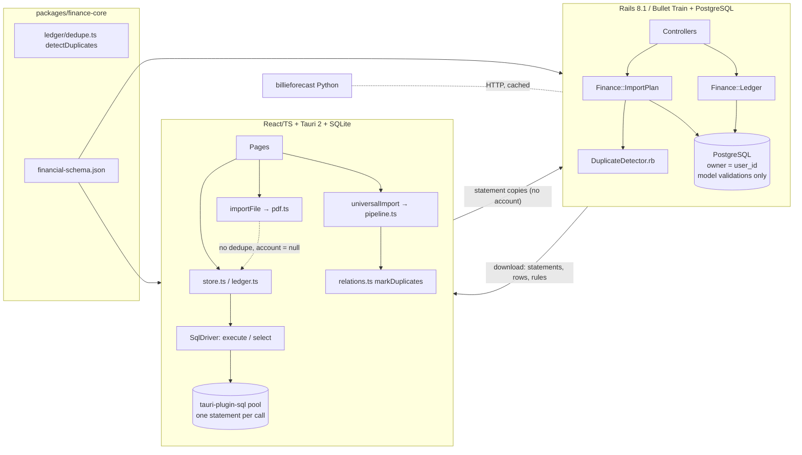
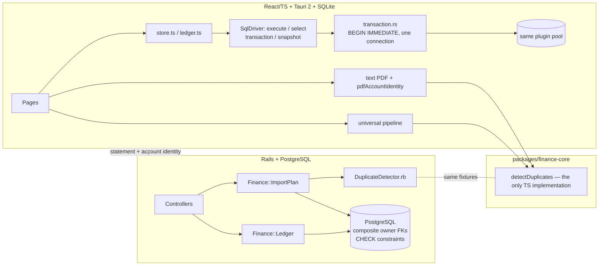
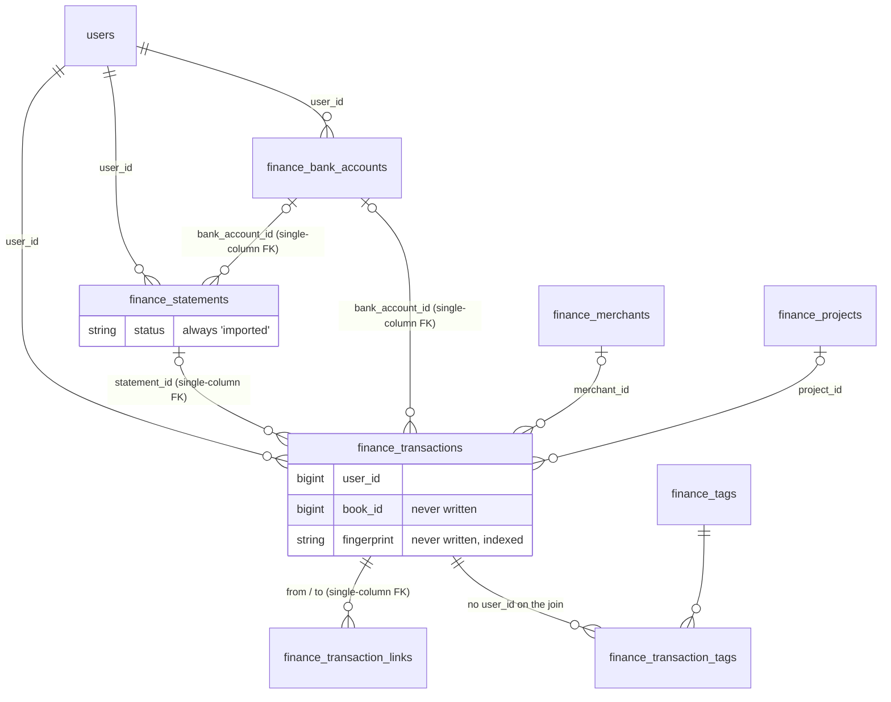
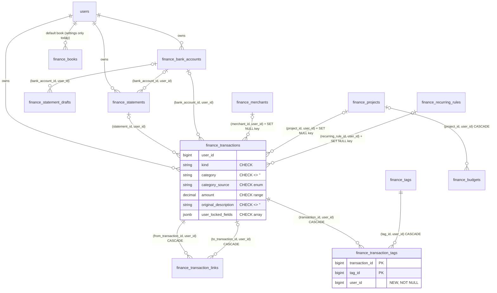
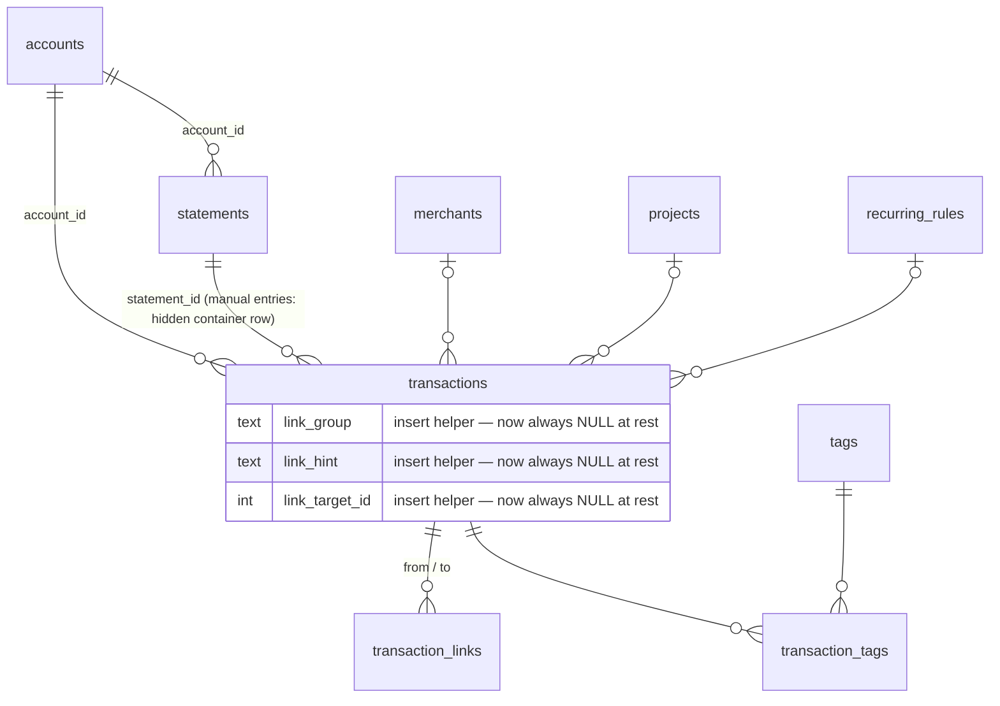

# BillieWeather 架构、数据库与工程跟进报告（Claude Fable 5.2）

**日期：** 2026-11-16　**模型：** Claude Fable 5.2（`claude-fable-5-2`，会话开始时已确认）
**基线：** `main @ cb84e71 (update1)`。Codex 的全部改动已包含在该提交中，开始时工作区是干净的，所以本报告列出的改动就是相对该提交的全部未提交差异。
**安全边界：** 没有提交、推送、部署；没有连接生产库（`.env.local` 指向远程 Neon，所有 Rails 命令都显式固定到 `postgresql://localhost/billieweather_codex_audit_test`，并在执行前核对了解析结果）；没有打开 `../local-db-backups-20261113/` 和 `../Statements/`；所有财务数据都是合成的。

阅读方式：每一项都标明 **已实现并验证**、**已实现、未做设备级验证** 或 **仅为建议（未实现）**。没有标注"已验证"的内容不要当作可发布。

---

## A. 整体健康状况

| 维度 | 结论 |
|---|---|
| 财务语义（kind、退款、转账、信用卡还款） | 良好。Codex 之后的混合账本模型是对的，本次没有推翻它。 |
| 账户隔离 | Web 端从"只靠模型校验"提升为"数据库强制"（复合外键）。本地端 owner 绑定沿用 Codex 的实现。 |
| 导入管线 | 文本 PDF 之前绕过了账户识别和逐行去重，现已并入同一套去重规则。TypeScript 里的两份去重实现合并为一份。 |
| 原子性（本地 SQLite） | 之前依赖触发器技巧加事后补偿删除；现在多语句操作走原生单事务命令。 |
| 备份/恢复 | 修复一个确认的缺陷（某些账本能备份但无法恢复）；导出改为单快照，恢复改为单事务并内含校验。 |
| 依赖安全 | 根 Yarn 树 38 条（3 critical / 14 high）→ 6 条 moderate。Ruby、Python 无告警。Rust 有 1 条无法在上游解决（见 J）。 |
| 发布就绪 | **未就绪。** 见 P。两个迁移都没有在真实数据上演练，原生事务命令没有在打包应用里跑过。 |

本次确认并修复的真实缺陷有两个（都有"旧代码失败、新代码通过"的证据）：

1. **0008 之前的账本无法从备份恢复。** 退款关联金额与退款金额不一致的账本（0008 不回填旧数据）可以导出备份，但恢复时被 0008 的守卫触发器拒绝，报 `refund_target_invalid`。
2. **0008 的退款上限守卫可被永久绕过。** 应用在"插入退款"和"清除插入辅助列"两条语句之间被杀掉时，残留的 `link_hint='refund_of'` 会让该行以后永远跳过守卫。探针复现：10,000 的支出上出现了 15,000 的有效退款。

---

## B. 当前架构（As-Is，基线 `cb84e71`）

基线的结构性问题：

- **去重规则有三份**：Ruby 一份（必要，跨语言），TypeScript 两份（`relations.ts` 和 `ledger/dedupe.ts`，逻辑重复）。
- **文本 PDF 是独立管线**：`importFile.ts → store.importStatement`，只按文件哈希去重，`accountKey` 恒为 null。
- **本地没有跨语句事务**：SQL 插件每条语句从连接池取连接，所以代码用触发器、暂存表、辅助列和"失败后再删"来模拟原子性；合并、恢复、删除全部、分类改名都是多条独立语句。
- **Web 归属只靠模型校验**：`insert_all!` / `update_all` / `update_columns` 会跳过校验，数据库本身不阻止一行指向别人的账户或对账单。
- **死结构**：11 张表上从未写入的 `book_id`、从未使用的 `fingerprint` 列及索引、恒为 `imported` 的 `status`。
- **传输契约不带账户**：设备上传到网站的对账单没有账户，网站端按账户的去重因此失效。

---

## C. 优化后的架构（To-Be，已实现部分）

仍然是原来的技术栈，没有引入新框架或微服务。变化集中在三处：数据库自己保证归属、本地有真正的事务、去重只有一份实现。

---

## D. 数据库 ER 图

### D.1 PostgreSQL —— 改造前（核心关系）

问题：每条引用只校验"目标行存在"，不校验"目标行属于同一个人"。

### D.2 PostgreSQL —— 改造后（已实现，迁移 `20261116000100`）

每个被引用的表都有 `UNIQUE (id, user_id)`，子表用 `(x_id, user_id)` 引用它，所以跨用户引用在数据库层面不可能出现。

### D.3 SQLite（每个文件一个账本）

表结构在本次**没有变化**；迁移 `0009` 只改触发器、清理派生/临时列并增加索引。逻辑关系与 `docs/architecture/finance-domain-spec.md` §7 的图一致：

---

## E. 逐表结构变更

### PostgreSQL（迁移 `db/migrate/20261116000100_enforce_finance_integrity.rb`，可逆，`schema.rb` 往返一致）

| 表 | 变更 |
|---|---|
| `finance_transactions` | 复合外键：statement、bank_account（替换单列键）；merchant、project、recurring_rule（保留单列 `SET NULL` 键并新增复合键）。CHECK：`category <> ''`、`category_source` 枚举、金额范围、`original_description <> ''`、`user_locked_fields` 必须是数组。删除 `book_id`、`fingerprint`（及索引）。索引：新增 `UNIQUE (id, user_id)`、`merchant_id`/`project_id` 部分索引、`(user_id, booked_on DESC, id DESC) WHERE deleted_at IS NULL`、回收站部分索引；删除被覆盖的 `user_id`、`(user_id, booked_on)`、`(user_id, deleted_at)`。 |
| `finance_statements` | bank_account 复合外键；CHECK：`transaction_count > 0`、`sha256` 格式；删除 `status`；`UNIQUE (id, user_id)`；删除冗余 `user_id` 索引。 |
| `finance_statement_drafts` | bank_account 复合外键。 |
| `finance_bank_accounts` | `UNIQUE (id, user_id)`；删除 `book_id` 和冗余 `user_id` 索引。 |
| `finance_transaction_links` | from/to 复合外键（CASCADE）；CHECK：两端不能是同一条、`amount >= 0`；删除 `book_id`。 |
| `finance_transaction_tags` | 新增 `user_id NOT NULL`（从分录回填）；两侧复合外键（CASCADE）；新增 `(user_id, tag_id)` 索引。 |
| `finance_budgets` | project 复合外键（CASCADE）；删除 `book_id`。 |
| `finance_merchants` / `finance_projects` / `finance_tags` / `finance_recurring_rules` | `UNIQUE (id, user_id)`；删除 `book_id`；前三者删除冗余 `user_id` 索引。 |
| `finance_audit_events` / `finance_category_settings` / `finance_organize_runs` | 删除 `book_id`；前两者删除冗余 `user_id` 索引。 |
| `finance_insights` / `finance_merchant_rules` / `finance_custom_categories` / `finance_local_devices` / `finance_local_database_reports` | 删除被其它索引覆盖的单列 `user_id` 索引。 |
| `finance_books`、`finance_profiles`、`finance_command_executions`、`finance_local_database_audits`、`finance_recurring_rules` 的其余结构 | 未变。 |

### SQLite（迁移 `0009_refund_guard_and_link_hygiene.sql`，纯追加；本地模式版本 8 → 9）

| 对象 | 变更 |
|---|---|
| `transactions.link_group / link_hint / link_target_id` | 清空遗留值（它们只是插入时的临时辅助列）。 |
| 触发器 `transactions_refund_update_guard` | 重建：只有"本条 UPDATE 自己把辅助列从空设为 `refund_of`"时才跳过，已存在的遗留值不再是跳过的理由。 |
| `transaction_links.amount_cents`（`refund_of`） | 与对应退款的金额对齐（派生值；0008 只在之后的编辑中保持同步）。 |
| 索引 | `transactions (booked_on DESC, id DESC) WHERE deleted_at IS NULL`、`transaction_links (from_transaction_id)`、`transaction_tags (tag_id)`、`statements (account_id)`。 |

没有任何分录的金额、日期、描述、分类、kind、账户被改动（有测试逐列比对迁移前后）。

---

## F. 架构决策与理由

**F1. 账本模型：保留混合模型（每行一条带 `kind` 的账户分录 + 显式关联），不改成完整复式。**
评估了三种：简单流水（已被证明会把退款/还款算成收入）、完整复式（银行对账单天然是单边的，每条未配对的行都要造一个对方科目，手工记账的用户也要理解借贷）、混合模型。混合模型对导入、手工记账、对账、现金流预测都是最简单且正确的；FinRx 的应收款以后可以用"存储的过账表"扩展而不改变用户模型。这一点与 Codex/之前的评审结论一致，本次没有改。

**F2. 归属下沉到数据库（已实现）。** 之前：只有模型校验。现在：复合外键。理由：批量写入会跳过校验，隔离是第一优先级，不能依赖"调用方今天都写对了"。代价：每个被引用表多一个唯一索引（见 K 的索引体积）。

**F3. 删除从未写入的 `book_id`，而不是把它补全（已实现）。** 两个选项：给 11 张表补上默认账本、加触发器和复合键；或者删掉。当前每个用户只有一个默认账本，`finance_books` 只提供月起始日和名称，没有多账本界面。一个可空、从不写入的列只会让人误以为存在账本隔离。现在的租户边界就是 `user_id`，并且是强制的。多账本上线时按同样的复合键模式加回 `book_id NOT NULL` 是机械工作。**这是一个可以推翻的判断**：如果你近期就要做 Web 多账本，应该现在就补全而不是删除。

**F4. 本地事务走原生命令，而不是继续堆触发器（已实现，未做设备级验证）。** `tauri-plugin-sql` 的连接池让 WebView 无法跨调用持有事务。新增两个命令（`db_transaction`、`db_snapshot`），在插件自己的连接池上取一条连接、`BEGIN IMMEDIATE`、全部成功才提交。已有的触发器（导入暂存、插入即建关联）保留，因为它们在事务内仍然正确，而且旧数据库依赖它们。

**F5. 恢复是"忠实复制"，不是"重新创建"（已实现）。** 恢复时不应重新执行属于"创建"的业务守卫，否则源账本里任何历史遗留都会让备份不可恢复。做法：受触发器监视的列先写中性值，行落地后再设为备份值；全程在一个事务内，校验也在事务内。

**F6. SQLite 不重排/合并历史迁移（有意不做）。** 你授权了对一次性开发数据的破坏性改动，但真实的用户本地 SQLite 文件不在授权范围内，而 sqlx 会校验已应用迁移的校验和——改写 0001–0008 会让现有真实文件打不开。所以只追加 0009。

**F7. PostgreSQL 分类仍是文本名，未改为外键表（未实现，见 O）。** 这是评审里的 P1 建议，会同时改动两端的导入、规则、预算、报表和传输契约，本次没有做。

**F8. Redocly 升到 2.x 并关闭两条新增规则（已实现）。** 1.x 把 handlebars 精确钉在有漏洞的版本上，无法在同一大版本内修复。2.x 的 `recommended` 多了两条 1.x 从未检查的规则；关闭它们后覆盖面与升级前相同，而不是更弱。21 条示例不匹配是 Bullet Train 模板生成文档的真实缺陷，记在 O。

---

## G. 实际的重构与简化

| 之前 | 之后 | 文件 |
|---|---|---|
| TypeScript 两份去重逻辑 | `markDuplicates` 只把 `detectDuplicates` 的结论翻译成行问题 | `packages/finance-core/src/universal/relations.ts`、`ledger/dedupe.ts` |
| 文本 PDF 无账户、无逐行去重 | `pdfAccountIdentity`（Rails `from_pdf` 的移植，同一组测试向量）+ `markPdfDuplicates`；有匹配就进入人工复核 | `packages/finance-core/src/pdf.ts`、`clients/universal/src/services/importFile.ts`、`components/PdfReview.tsx` |
| 多账户导入：逐账户提交，失败后补偿删除 | 整个文件一个事务，补偿代码删除 | `store.ts`（`stagedStatements` / `commitImport`） |
| 手工分录：INSERT 后再单独清辅助列、再更新计数 | 三条语句一个事务 | `ledger.ts`（`createEntry`） |
| 合并数据库：每张对账单各自提交 + 补偿删除 | 整次合并一个事务 | `store.ts`（`mergeData`） |
| 删除对账单、分类改名/删除、删除全部 | 各自一个事务（含审计记录） | `store.ts`、`ledger.ts` |
| 备份导出：每表一次独立读取 | 所有表一个读事务 | `backup.ts`（`createBackup`） |
| 恢复：逐条写入，失败后清空目标库 | 一个事务，校验在事务内，失败即回滚；清理代码删除 | `backup.ts`（`restoreInto`） |
| 上传不带账户 | 上传和本地合并都带账户身份 | `cloudUpload.ts`、`store.ts`、`finance_controller.rb` |

没有做的简化：`applyWebData`（网站下载的应用）仍是多语句。它是收敛的（重复执行会补齐），所以优先级较低，但不是原子的。

---

## H. Codex 改动的核验、改进与替换

| Codex 改动 | 结论 |
|---|---|
| 测试基线（Rails 648 通过 / 2 跳过、客户端 689、Rust 15、Python 55） | **已复现**，数字完全一致。 |
| SQLite `0008_refund_integrity.sql` | **保留并修补**。守卫思路正确，但有一个可被永久绕过的条件（见 I-2），并且与恢复流程冲突（见 I-1）。没有改写 0008 本身，用 0009 修正。 |
| "备份清单由捕获的行计算"（Codex 明确说未解决时间点一致性） | **替换**为单快照读取，问题本身被消除。 |
| 恢复前的校验（格式、版本、清单、SHA-256、外键） | **保留**；写入部分替换为单事务。 |
| 传输保留 `kind` 和 `original_description` | **保留并扩展**为同时携带账户身份。 |
| 账户/日期范围内的去重候选查询 | **保留**；新的部分索引服务同一查询。 |
| 归属确认、令牌与身份绑定、快照归属检查 | 阅读过相关代码，**未改动、未独立做对抗性测试**；对应的 Codex 测试在全量运行中通过。 |
| 根 Yarn 留下的 3 条 critical | **已解决**（见 J）。 |
| Codex 遗留风险 1（文本 PDF）、3（合并与备份的一致性）、4（Yarn） | **已处理**。风险 2（云端只是对账单副本）**部分处理**（加了账户身份，其余不变）。风险 5–8 未处理。 |

---

## I. 财务完整性与功能缺陷修复

**I-1. 含旧退款关联的账本无法恢复（确认缺陷，已修复并验证）**
- 之前：0008 的 `transaction_links_refund_guard` 在恢复插入关联时触发，要求关联金额等于退款金额；0008 不回填旧数据，所以旧账本的备份恢复失败。
- 证据：同一个新测试在旧 `backup.ts` 上失败（`BackupError: … refund_target_invalid`），在新代码上通过。
- 修改：恢复改为忠实复制 + 单事务；0009 另外把旧关联金额对齐。
- 测试：`clients/universal/test/backup.test.ts`「atomic, faithful restore」4 条。
- 兼容性：备份格式不变；模式版本 9 的备份不能被旧版应用读取（既有规则）。

**I-2. 退款上限守卫可被遗留辅助列绕过（确认缺陷，已修复并验证）**
- 之前：守卫条件含 `COALESCE(NEW.link_hint,'') <> 'refund_of'`，而辅助列靠第二条独立语句清除。
- 证据：探针得到 `liveRefunds: 15000, expense: 10000`。
- 修改：0009 重建守卫并清理遗留；`createEntry` 改为单事务，辅助列不会再残留。
- 测试：`clients/universal/test/refundIntegrity.test.ts`「refund guard does not depend on insert-time helpers」4 条，含 8→9 升级前后逐列比对。

**I-3. 文本 PDF 导入没有账户、没有逐行去重（Codex 遗留风险 1，已修复并验证）**
- 修改：从 PDF 文本识别账户（只保留后四位；日期开头的交易行不参与识别；多个账户或类型时判为未识别）；用共享去重器比对；任何匹配都进入复核，"已导入"的行默认不勾选，"疑似"的行默认保留；信用卡账单上的入账不再记为收入。
- 测试：`packages/finance-core/test/pdf.test.ts`（7 条新增）、`clients/universal/test/pdfImport.test.ts`（5 条端到端合成场景）。
- 未验证：`PdfReview` 组件新增的提示和默认勾选只经过类型检查和既有页面测试，没有专门的界面测试。

**I-4. Web 端跨用户引用只靠模型校验（已修复并验证）** —— 见 E/F2。测试：`test/models/finance/schema_integrity_test.rb`（8 条、31 个断言），覆盖 `insert_all!`、`update_all`、`update_columns`、关联、标签、预算，以及删除商家/项目后引用被清空而分录保留。

**I-5. 上传的对账单没有账户（已修复并验证）** —— 设备发送 `{institution, last4, kind}`，网站归到与自己导入同一张卡相同的账户；同账户重叠上传只新增新行，另一账户的相同行保留；带完整卡号或格式错误的账户身份被拒绝。测试：`test/integration/client_api_finance_test.rb`（3 条新增）、`clients/universal/test/transferIntegrity.test.ts`（3 条新增）。

**I-6. 多语句操作非原子（Codex 遗留风险 3，大部分已修复并验证）** —— 见 G。测试用"在事务中途注入必然失败的语句"验证回滚后不留任何痕迹。

**未发现新问题但也未深入的范围：** 预测（Python）、AI 分类、智能命令、周期记账的业务逻辑本次没有审查，只跑了现有测试。

---

## J. 安全与依赖

| 生态 | 之前 | 之后 | 说明 |
|---|---|---|---|
| 根 Yarn（Rails 资源与工具链） | 38 条：3 critical、14 high、20 moderate、1 low | **6 条 moderate，0 critical/high** | `@redocly/cli` 1.x → 2.79（并移到 `devDependencies`：它只被一个测试用来校验 OpenAPI 文档，不进任何运行时包），去掉 handlebars、旧 faker、旧 undici；`node-gyp` 10 → 13，`tar` 6.2.1 → 7.5.23。安装时禁用了安装脚本。 |
| 客户端 npm | 0 | 未重新扫描（`package.json` 未改） | — |
| Ruby（bundle-audit） | 无告警 | 无告警 | 数据库更新于 2026-11-16。 |
| Brakeman | 1 条弱置信度 | 1 条弱置信度（同一条 HTTP 动词） | 未压制。 |
| Python（OSV，81 个锁定包） | Codex 未扫描 | 0 | 用 OSV 公共接口按锁文件精确版本查询。 |
| Rust（OSV，544 个锁定包） | Codex 未扫描 | 7 条，其中 **1 条实际编译进应用** | 见下。 |

剩余的 6 条 moderate：`glob`（2）、`inflight`、`minimatch`、`postcss-selector-parser`、`@icon/themify-icons` 的弃用提示——都在构建工具链里，其中三条是"已弃用"而非漏洞。没有强行覆盖。

**Rust 明细：** `glib`、`zvariant`、`zbus_names`、`zvariant_derive`、`rsa`、`proc-macro-error` 在本机（macOS）目标上都不参与编译（Linux GTK/DBus 依赖、未启用的 MySQL 驱动、构建期宏），其中四条是"无人维护"提示。**`libsqlite3-sys 0.30.1`（RUSTSEC-2026-0459）是真实且未解决的**：它打包的 SQLite 在打开"页大小不一致的数据库与 `-wal` 文件对"时可能返回未初始化内存；修复版本是 `libsqlite3-sys 0.39.0`，而已发布的 sqlx（包括 0.9.0）都要求 `< 0.38`，`tauri-plugin-sql` 稳定版仍用 sqlx 0.8。没有可用的兼容升级路径，我没有强行覆盖。攻击前提是本地攻击者能把构造的文件放进应用数据目录；我没有进一步评估可利用性。

**配置审查（只读，未改）：** 客户端登录有速率限制和账户锁定；CORS 只对 Tauri 来源开放 `/api/client/v1/*`；生产强制 SSL；Tauri 权限只有 SQL、对话框、读写用户选定文件、打开链接。**CSP 初始化文件仍是注释掉的模板**，网站没有内容安全策略——未处理，因为对 Bullet Train 的内联脚本贸然开启会破坏页面。新增的两个 Tauri 命令只接受本应用的 8 个数据库槽位名。

---

## K. 性能测量

**PostgreSQL**（本机 PostgreSQL 18.6，一次性测试库，80,000 条合成分录分属两个用户；每次测量前 `VACUUM FULL`，三轮取中位数；查询时间是服务器端 `EXPLAIN ANALYZE` 执行时间）。脚本和原始结果：`docs/audits/evidence/2026-11-16-fable/`。

| 指标 | 之前 | 之后 |
|---|---:|---:|
| 按商家查分录（删除/合并商家时数据库要做的查找） | 5.18 ms，**顺序扫描** | 0.043 ms，索引 |
| 某用户某商家的分录 | 4.53 ms | 0.125 ms |
| 最新 50 条有效分录 | 0.088 ms | 0.047 ms |
| 回收站 50 条 | 0.043 ms | 0.045 ms（无变化） |
| 当月按 kind 汇总 | 0.425 ms | 0.446 ms（无变化） |
| 批量插入 60,000 行 | 2,643 ms | 2,553 ms（噪声范围内，等于没变） |
| `finance_transactions` 索引数 / 体积 | 10 / 12.9 MB | 11 / **17.2 MB（变大）** |

如实解读：收益集中在商家/项目查找（从全表扫描变成索引）和列表查询。插入吞吐量没有改善也没有因为新增外键而变差。索引体积**增加了约三分之一**，这是归属复合键需要 `UNIQUE (id, user_id)` 的代价；"删除冗余索引"并没有让总体积变小。这些是本机单次环境的数字，不代表 Neon 上的延迟。

**客户端包体积：** 主入口 chunk 923.79 kB（gzip 293.49 kB），与 Codex 的 913.97 kB 基本相同（本次功能代码略增）。**没有做优化。** 分析结论：主 chunk 里约 410 kB 源码是 6 种语言的文案被同时加载，其中 5 种每次会话都用不到；按语言拆分需要把 `universal.ts`、`ledgerLocales.ts`、两个生成的 JSON 和命令文案都按语言切开，并改测试的同步加载假设，本次没有做。

**没有测量的：** 应用启动时间、React 渲染、内存、PDF/OCR 耗时、导入吞吐（客户端）、预测执行。这些在任务清单里，但本次没有做，也没有相应的前后数据。

---

## L. 数据库兼容性与破坏性变更

| 变更 | 对一次性开发/测试库 | 对真实数据的含义 |
|---|---|---|
| PG：删除 `book_id`（11 表）、`fingerprint`、`statements.status` | 已应用到测试库 | 这些列应用从不写入或恒为常量，按代码判断不丢信息——**但我没有看过生产库，无法确认里面确实是空的**。上线前先查一遍。回滚迁移会重建空列。 |
| PG：复合外键与 CHECK | 已应用 | 如果生产库已有违反的行（例如历史上某次批量写入造成的跨用户引用，或空分类），**迁移会失败并且不改任何数据**——这是预期信号，需要先处理那些行。大表上加外键会全表校验并持锁；对个人规模的数据不是问题，规模大时应改用 `NOT VALID` + `VALIDATE`。 |
| PG：`finance_transaction_tags.user_id` | 已回填 | 回填来自分录的 `user_id`，无歧义。 |
| SQLite：迁移 0009 | sql.js 测试中已应用 | 纯追加；Rust 侧会在迁移前自动复制数据库文件。应用了 0009 的文件不能再被旧版应用打开（既有规则）。**没有在任何真实的本地数据库文件上运行过。** |
| 备份格式 | 不变，`schemaVersion` 9 | 旧备份可恢复到新版；新备份不能被旧版读取。 |
| 上传接口 | 新增可选字段 `statement.account` | 向后兼容：旧客户端不发送该字段，行为不变。新客户端对旧服务器发送时该字段被忽略。 |
| Redocly 配置 | `.redocly.yaml` → `redocly.yaml` | CI 或脚本里若引用旧文件名需要同步（仓库内唯一的引用已更新）。 |

---

## M. 自动化与界面测试结果

| 套件 | Codex 基线（本次已复现） | 最终 |
|---|---|---|
| Rails（固定到本地测试库） | 650 运行 / 648 通过 / 2 跳过 | **661 运行 / 0 失败 / 0 错误 / 2 跳过（659 通过）**，25,018 个断言，行覆盖率 95.41%（新增 11 条） |
| 客户端 + 共享包（Vitest） | 689 通过 | **58 个文件，712 通过，0 失败**（新增 23 条） |
| Rust（`cargo test --locked`） | 15 通过 | **19 通过**（新增 4 条）。首次运行因磁盘只剩约 400 MB 而失败（`No space left on device`），清理本 crate 的构建缓存后通过——与代码无关，但这台机器的磁盘基本已满 |
| Python（pytest） | 55 通过 | **55 通过**（代码未改） |
| 客户端生产构建（`tsc` + Vite） | 通过 | 通过；主 chunk 923.79 kB / gzip 293.49 kB |
| Rails 资源构建（JS、CSS） | 通过 | 通过（依赖升级后；CSS 输出与升级前逐字节相同） |
| OpenAPI 文档校验（Redocly 2.79） | 通过（1.x） | 通过 |
| Chromium 冒烟（`scripts/audit-smoke.mjs`） | 通过 | **通过**（回环 Vite 开发服务器：手工账户 → 支出 → 关联退款 → $950 净资产 → 模式切换 → 懒加载报表；无外部请求）。只跑了开发服务器，没有跑生产预览 |
| PG 迁移可逆性 | — | down → up 后 `schema.rb` 完全一致 |

两条跳过的 Rails 测试是基线里就有的（团队成员销毁、CreativeConcepts 临时重定向）。

你在任务里列出的数据库测试项对应情况：全新建库（Rails 测试库由 `schema.rb` 加载；SQLite 每个测试从 0001 迁移到 0009）✓；核心关系与账户隔离 ✓；财务不变量 ✓；合成导入 ✓；退款与转账 ✓；手工记账 ✓；备份恢复 ✓；报表一致性（仅现有测试）；**应用启动与重启：没有做**——没有启动过打包的原生应用。

---

## N. 改动的文件

**Rails / PostgreSQL**
- `db/migrate/20261116000100_enforce_finance_integrity.rb`（新）、`db/schema.rb`
- `app/controllers/client_api/v1/finance_controller.rb`、`app/models/finance/statement.rb`、`app/models/finance/transaction_tag.rb`、`app/services/finance/statement_importer.rb`、`app/services/demo_account/seeder.rb`
- `test/models/finance/schema_integrity_test.rb`（新）、`test/integration/client_api_finance_test.rb`、`test/services/finance/categorizer_test.rb`

**共享包**
- `packages/finance-core/src/pdf.ts`、`src/ledger/dedupe.ts`、`src/universal/relations.ts`、`test/pdf.test.ts`

**客户端**
- `clients/universal/src/services/`：`store.ts`、`ledger.ts`、`backup.ts`、`importFile.ts`、`cloudUpload.ts`、`platform.ts`、`sqljsDriver.ts`
- `clients/universal/src/components/PdfReview.tsx`
- `clients/universal/test/`：`backup.test.ts`、`pdfImport.test.ts`、`refundIntegrity.test.ts`、`transferIntegrity.test.ts`、`universalImport.test.ts`、`commands/billieCommands.test.ts`

**Tauri / Rust**
- `clients/universal/src-tauri/src/transaction.rs`（新）、`src/lib.rs`、`Cargo.toml`、`Cargo.lock`
- `clients/universal/src-tauri/migrations/0009_refund_guard_and_link_hygiene.sql`（新）

**工具链与文档**
- `package.json`、`yarn.lock`、`.redocly.yaml` → `redocly.yaml`、`bin/configure-scripts/update_configs.rb`
- `docs/architecture/finance-domain-spec.md`、本报告、`docs/audits/evidence/2026-11-16-fable/`

两处被修改的既有测试断言，都是因为注入失败的方式变了，而不是放宽要求：`universalImport.test.ts` 和 `billieCommands.test.ts` 原来通过让 `execute` 抛错来模拟中途失败；导入现在走事务，所以改为在事务中途注入一条必然失败的语句，"不留痕迹"的断言保持不变。`pdf.test.ts` 的 Ruby 对照断言现在排除新增的 `account` 字段（它有单独的向量测试）。

---

## O. 未解决的风险与未完成的工作

**任务清单中没有做的部分（按影响排序）**

1. **原生事务命令没有在打包应用里验证。** Rust 单元测试用的是真实的多连接文件库，逻辑是对的；但 WebView → `invoke` → 插件连接池这条路径、大批量恢复时的 IPC 负载、iOS/Android/Windows 都没有跑过。在这之前不要发布客户端。
2. **两个迁移都没有碰过真实数据。** PG 迁移需要先在 Neon 分支上演练；0009 需要在一份真实本地库的副本上演练。
3. **分类仍是文本名**，没有改成带稳定键的外键表；`finance_source_records`（原始行与规范分录分离）和 `finance_balance_observations` 也没有做；`finance_profiles.current_balance / cash_on_hand` 与账户余额的重复表示仍在；`finance_bank_accounts.kind` 与 `account_type` 的重复仍在。这些是真正的"数据库重新设计"里还没动的部分。
4. **`applyWebData` 仍非原子**（收敛但会有中间态）。
5. **云端传输仍不是完整同步**：手工分录、关联、维度、预算、周期规则只能通过备份文件迁移；网站仍只有一个账本。
6. **性能工作基本没做**：包体积未优化，客户端启动/渲染/内存/导入吞吐/OCR 均未测量。
7. **Manual / Default 模式**：没有改动也没有专门审查；两种模式本来就共用同一套 `Ledger` / `LedgerStore`，本次改动没有引入第二套记账引擎。
8. **AI 架构、预测、认证流程**：没有审查。

**已知的遗留风险**

- `libsqlite3-sys`（RUSTSEC-2026-0459）无上游修复路径。
- 网站没有 CSP。
- `PdfReview` 新界面行为没有专门的界面测试。
- Bullet Train 生成的 OpenAPI 文档里有 21 处示例与模式不符（现在被显式关闭的规则会报出来）。
- PG `original_description` 的不可变性仍只靠模型的 `attr_readonly`；用触发器强制需要把 `schema.rb` 换成 `structure.sql`，没有做。
- 索引体积增加约三分之一（见 K）。
- Web 端信用卡单列金额的正负号确认（Codex 遗留风险 6）未处理。
- 本地 SQLite 未做静态加密。

---

## P. 发布就绪评估

**结论：不能发布。可以进入"在副本上演练"的阶段。**

| 组件 | 状态 |
|---|---|
| Rails 代码 + PG 迁移 | 在本地测试库上全量通过。发布前必须：在 Neon 分支上跑迁移并确认被删除的列在生产中确实为空、没有违反新约束的行。 |
| 共享包（去重、PDF 账户识别） | 已验证，可随客户端发布。 |
| 客户端 JS | 已在 sql.js 上验证。依赖下面一行。 |
| Tauri 原生（事务命令、迁移 0009） | **未做设备级验证。** 需要：打包 macOS 应用，用合成数据走一遍导入 → 手工退款 → 备份 → 恢复到新槽位 → 重启；再用一份真实库的**副本**跑 0009。 |
| 依赖 | 根 Yarn 可接受；Rust 的 SQLite 告警需要你决定是否接受（本地攻击前提）。 |

建议的下一步顺序：① Neon 分支演练 PG 迁移；② macOS 打包应用的合成全流程；③ 在真实本地库副本上跑 0009 并比对总额；④ 再决定是否做 O-3 里的分类表和源记录表。
